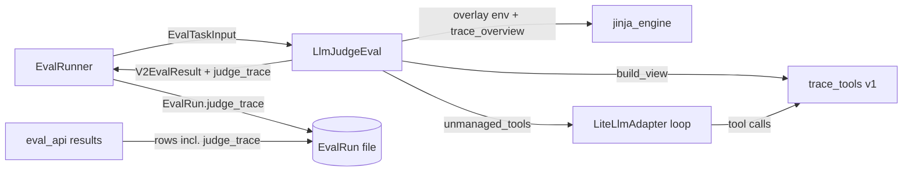

# Architecture: Agentic Eval

Implements [functional_spec.md](functional_spec.md). The exact behavior of trace toolset v1 (formats, algorithms, descriptions, schemas, error text) is in [components/trace_tools_v1.md](components/trace_tools_v1.md).

## 1. Decisions

| Decision | Choice | Why |
|----------|--------|-----|
| Judge type | **Option on the LLM judge** (`LlmJudgeProperties.trace_toolset_version`, `None` = off), not a new `V2EvalType` | One judge with a capability. Everything an LLM judge has (prompt, model, run settings, judge traces, default prompt builder, UI form) is shared, not copied. Incompatible combinations are validation errors. |
| Where the trace tools live | `libs/core/kiln_ai/adapters/eval/trace_tools/`, one self-contained subpackage per toolset version (`v1/`) | Only judges use them. A frozen version must not share code that could change under it. |
| How `trace_overview` reaches templates | `utils/jinja_engine` registers a **placeholder** filter; the LLM judge renders through an **overlay environment** that binds the real, version-specific filter | `utils/` must not import `adapters/` (layering rule). Templates still compile everywhere (Jinja rejects unknown filters at compile time). |
| Judge trace storage | New field `EvalRun.judge_trace`, typed like `TaskRun.trace` | User decision: the judge trace belongs to the score record. Storage cost accepted. |
| Judge trace in results | Returned inline, on each row's `eval_run`, like the judged trace already is | The only consumer is the per-judge results page, a drill-down that loads once on open and already holds every row's full judged trace in memory. A separate endpoint would add code to save memory the page already spends. If large traces make that page slow, lazy-loading both kinds of trace is a separate fix. |
| Tool errors | Handled in the model adapter by a **separate task**: argument mistakes and exceptions raised by tools become error results returned to the model | A general adapter bug, not specific to this project. Every tool benefits, and the trace tools can simply raise. Must merge first (§4). |
| Structured output with tools | Keep the LLM judge's current mode selection, and send it only on a separate, final scores-only turn (§3.7) | User decision, after real-provider runs (§7.8) showed models writing prose around their JSON when the tools and the score format share one turn. |
| Eval builder | No support in v1 | User decision. |
| CPU-heavy work | `asyncio.to_thread` | Parsing and searching a 20 MB trace must not block the event loop, which runs up to 25 judgments at once. |

## 2. Data Model Changes

### 2.1 Version constants (`datamodel/eval.py`)

```python
LATEST_TRACE_TOOLSET_VERSION = 1
# The overview used by judges with trace tools off. Fixed forever, so their prompts never change.
TRACE_OVERVIEW_VERSION_WITHOUT_TOOLS = 1
```

### 2.2 `LlmJudgeProperties` (`datamodel/eval.py`)

One new field:

```python
trace_toolset_version: int | None = Field(
    default=None,
    ge=1,
    description="Trace tools for the judge model: read-only tools for reading the judged trace. None: off. A version number: on, with that version's tools and trace_overview output, locked for the life of the judge.",
)
```

- **Why one field.** One field means "off" and "on at version N" can't disagree, and judges saved before this field load as "off" with no migration.
- **Why an int and not an enum.** Older Kiln builds must still load configs written by newer ones. An enum would reject an unknown version and break loading the whole eval. An int loads fine, and building the judge fails with a clear message (§3.7).
- **The `trace_overview` lock for tools-off judges.** A judge with tools off always renders the v1 overview (`TRACE_OVERVIEW_VERSION_WITHOUT_TOOLS`). That keeps its prompt stable (functional spec §5.4) without storing anything. The trade-off: tools-off judges never get later overview formats.
- **New model validator:** `g_eval and trace_toolset_version is not None` raises `ValueError(G_EVAL_WITH_TRACE_TOOLS_ERROR)`, whose text is "G-Eval scoring can't be combined with trace tools."
- **`EvalConfig.validate_v2_templates_and_expressions`:** the "must reference `final_message`, `trace` or `task_input`" rule applies only when `trace_toolset_version is None`.

### 2.3 `EvalRun.judge_trace` (`datamodel/eval.py`)

```python
judge_trace: list[ChatCompletionMessageParam] | None = Field(
    default=None,
    description="The judge's own message history for this judgment: system prompt, rendered prompt, tool calls and results, and final answer. None for non-LLM judges, judgments skipped before the judge model was called, and records that predate this field.",
)
```

- Add a `model_validator(mode="after")` that calls `materialize_lazy_content(self.judge_trace)`, same as `TaskRun` (`datamodel/task_run.py:145`). Without it, list-typed `content` serializes once and then as `[]`.
- Not in `LEGACY_TRACE_FIELDS`. It is not a copy of the scored trace, so `validate_record_mode` allows it on pointer records.

### 2.4 `V2EvalResult` (`datamodel/eval.py`)

```python
judge_trace: list[ChatCompletionMessageParam] | None = None
```

With the same `materialize_lazy_content` validator as `EvalRun.judge_trace`.

## 3. Components



### 3.1 Trace tools package

```
libs/core/kiln_ai/adapters/eval/trace_tools/
  __init__.py        # public API: trace_toolset(), TraceToolset, TraceViewProtocol,
                     #   UnsupportedTraceToolsetVersion, judge_template_env()
  toolset.py         # TraceToolset protocol + trace_toolset(version) dispatch
  template_env.py    # judge_template_env(): the judge's template environment
  v1/
    __init__.py      # TOOLSET_V1: TraceToolset
    view.py          # TraceView, MessageView, ToolCallRef: parse + canonicalize once
    render.py        # overview, preview lines, read blocks, windows, refusals
    search.py        # matching with regex timeout
    pattern_check.py # regex size estimate, checked before compiling
    tools.py         # the trace tool class, parse_args() + build_tools()
    definitions.py   # tool names, descriptions, JSON schemas (frozen text)
    limits.py        # numeric limits (frozen)
    errors.py        # TraceToolUsageError
    conftest.py      # --update-trace-tool-goldens option
    golden/          # fixture traces, cases, expected outputs
    test_*.py
```

**Protocol** (`toolset.py`):

```python
class TraceToolset(Protocol):
    version: int
    def build_view(self, trace: Sequence[Mapping[str, Any]]) -> "TraceViewProtocol": ...
    def render_overview(self, view: "TraceViewProtocol") -> str: ...
    def build_tools(self, view: "TraceViewProtocol") -> list[KilnToolInterface]: ...
    @property
    def judge_thinking_instruction(self) -> str: ...  # first-turn instruction (§3.7)

class UnsupportedTraceToolsetVersion(Exception): ...

def trace_toolset(version: int) -> TraceToolset:
    match version:
        case 1:
            from kiln_ai.adapters.eval.trace_tools.v1 import TOOLSET_V1
            return TOOLSET_V1
        case _:
            raise UnsupportedTraceToolsetVersion(version)
```

- `TOOLSET_V1` is a stateless, immutable instance. No module-level mutable state.
- The view type is opaque outside a version: each version owns its canonicalization, because canonical text determines sizes, offsets and search positions, and those are locked per version.

**Freezing v1.** Nothing under `v1/` imports from another version or from shared trace-tools code that could change. It may import only stable primitives: `open_ai_types` constants, the `tools.base_tool` types (`UnmanagedKilnTool`, `ToolCallResult`, `ToolCallError`, `KilnToolInterface`, `ToolCallContext`), `build_kiln_unmanaged_tool_id`, `jsonschema` and `regex`. Golden tests (§7.2) fail on any output change. A v2 starts as a copy of `v1/`.

### 3.2 `TraceView` (v1)

Built once per judgment, in a worker thread:

```python
@dataclass(frozen=True)
class ToolCallRef:
    name: str
    arguments: str              # canonical (see component doc)
    call_id: str | None
    result_number: int | None   # message number of its tool result, if any

@dataclass(frozen=True)
class MessageView:
    number: int                 # 1-based
    role: str                   # system | developer | user | assistant | tool (function -> tool)
    content: str                # canonical text, "" if none
    reasoning: str
    tool_calls_text: str        # canonical "name {args}" lines, task_response excluded
    tool_calls: tuple[ToolCallRef, ...]
    tool_name: str | None       # tool results: name of the call it answers ("unknown tool" if unresolved)
    is_error: bool              # tool results marked is_error

@dataclass(frozen=True)
class TraceView:
    messages: tuple[MessageView, ...]
    def message(self, number: int) -> MessageView: ...
    def part_text(self, number: int, part: Part) -> str: ...
```

- **Two passes, O(total chars).** Pass 1 canonicalizes every message. Pass 2 walks the messages in order and links each tool result to an earlier call with the same `id` that has no result yet, which gives the result its tool name and the call its `result_number`. Ids can repeat across turns, so the link is never by id alone ([component doc §2.5](components/trace_tools_v1.md#25-tool-result-metadata-role-tool)).
- This replaces the O(n²) name lookup in `EvalTraceFormatter`.
- **Accepts loose dicts.** `EvalTaskInput.trace` is `list[dict]`, so the view accepts loose dicts and never raises on odd shapes. A missing role becomes `"unknown"`. Non-string content falls back to the component doc's rules.
- Canonicalization rules are in the [component doc §2](components/trace_tools_v1.md#2-canonical-text).

### 3.3 Tools (v1)

- **One class, five instances.** `_TraceTool(UnmanagedKilnTool)` takes a `TraceView` and one row of the tool table in `tools.py`: the tool's definition, its argument parser and its pure function. Tool ids are `build_kiln_unmanaged_tool_id("trace_v1_<name>")`.
- **What `_TraceTool.run(context, **kwargs)` does:**
  1. Re-validates `kwargs` against the tool's JSON schema. This is defensive, for SDK callers that bypass the adapter.
  2. Applies defaults.
  3. Runs the tool's pure function `execute(view, args) -> str`. `search_trace` and `read_messages` run in `asyncio.to_thread`. The others are cheap and run inline.
  4. Returns `ToolCallResult(output=text)`.
- **Errors are raised, not caught.** The tools do not catch exceptions. The model adapter turns every exception from a tool into an error result for the model (§4):
  - A judge mistake, or a refused oversized response, raises `TraceToolUsageError(ToolCallError)`. The adapter returns its message as-is and doesn't log a stack trace, because these are expected.
  - Any other exception is a bug. The adapter logs it with its stack trace and returns a short error. The judgment continues, which keeps the functional spec's promise.
  - Trace content is never logged.
- **`build_tools(view)`** returns the five tools in a fixed order: `trace_overview`, `preview_messages`, `read_messages`, `read_message_text`, `search_trace`.

### 3.4 Search (v1)

- **Engine.** Uses the `regex` package (already a `kiln_ai` dependency) for its `timeout=` support:
  - literal mode compiles `regex.escape(pattern)`;
  - matching is case-insensitive by default (`regex.IGNORECASE`), with no full case folding, so offsets stay exact.
- **Time limit.** One 30-second deadline per call. Each `finditer` gets the remaining time, and a `TimeoutError` becomes a usage error.
- **Counting.** Matches are counted in full, for the "N matches in K messages" line. Only the page `[offset, offset+count)` is rendered.
- Details are in the [component doc §6](components/trace_tools_v1.md#6-search_trace).

### 3.5 Response size limit

Implemented once in `render.py`:

```python
@dataclass(frozen=True)
class Unit:            # one line or block of a response
    message_number: int
    text: str

def assemble(units, header, footer, refusal: RefusalContext) -> str  # raises TraceToolUsageError
```

- `assemble` joins the units. If the result exceeds `RESPONSE_CHARS = 40_000` (`limits.py`), it computes the longest prefix of units that fits and raises a refusal naming that range, using the tool-specific advice in `RefusalContext`.
- **Which tools it applies to:** `preview_messages`, `read_messages` and `search_trace`. `read_message_text` is bounded by `max_chars ≤ 40,000` plus a fixed-size header. `trace_overview` is bounded by construction.

### 3.6 `trace_overview` in templates

- **`utils/jinja_engine.py`** registers a placeholder in `_template_env`:

  ```python
  def _trace_overview_placeholder(value: Any) -> str:
      raise JinjaExtractionError("trace_overview is only available in LLM judge prompt templates.")
  _template_env.filters["trace_overview"] = _trace_overview_placeholder
  ```

  Templates that use it then compile in datamodel validation, and in any other environment it fails clearly.
- **`trace_tools/template_env.py`** provides the judge's environment, and `trace_tools` re-exports it. It builds on `template_env_with_filters` in `utils/jinja_engine.py`, which returns an overlay of `_template_env` with a filters dict of its own:

  ```python
  # utils/jinja_engine.py
  def template_env_with_filters(filters: Mapping[str, Callable[..., Any]]) -> Environment:
      env = _template_env.overlay()
      # overlay() shares the parent's filters dict by reference; assign a new dict
      # so the parent's placeholder is never replaced.
      env.filters = {**_template_env.filters, **filters}
      return env

  # adapters/eval/trace_tools/template_env.py
  def judge_template_env(toolset: TraceToolset, trace: list[dict[str, Any]] | None, view: TraceViewProtocol | None) -> Environment:
      return template_env_with_filters({"trace_overview": _trace_overview_filter(toolset, trace, view)})
  ```

- **How the filter gets its view.** `_trace_overview_filter` returns a closure. If called with the judge's own `trace` list (identity check), it reuses the prebuilt `view`. If none was built, because tools are off, it builds one on first use and keeps it in the closure. Any other value must be a list of dicts, or it raises `JinjaExtractionError`, which becomes the existing `extraction_failed` skip. A new environment per judgment means no module-level cache.

### 3.7 `LlmJudgeEval.evaluate` (`adapters/eval/v2_eval_llm_judge.py`)

**When the judge is built** (`LlmJudgeEval.__init__`): `self._toolset = trace_toolset(props.trace_toolset_version if tools_on else TRACE_OVERVIEW_VERSION_WITHOUT_TOOLS)`. `UnsupportedTraceToolsetVersion` raises `ValueError("This judge uses trace tools version {n}, which this version of Kiln doesn't support. Update Kiln to run it.")`. It is not a skip, because the runner saves a skip as a final result and counts it as done, so the items would stay unscored after the update. The runner builds the judge before it generates the trace, so each job fails before any model call and saves nothing, and the test endpoints return the message as a 400.

New flow (unchanged steps elided):

1. Reference-key checks: unchanged.
2. `tools_on = props.trace_toolset_version is not None`.
3. **If `tools_on` and `eval_input.trace` is empty or None:** return a `missing_trace` skip.
4. `toolset = self._toolset`, the toolset resolved when the judge was built.
5. `namespace = eval_input.model_dump()` plus `judge_instructions`: unchanged.
6. **If `tools_on`:** `view = await asyncio.to_thread(toolset.build_view, namespace["trace"])`. Otherwise `view = None`.
7. Render with `judge_template_env(toolset, namespace["trace"], view)` in `asyncio.to_thread`, with the existing error-to-skip mapping. The thread matters for tools-off judges too: a template that uses `trace_overview` builds its view during the render, and `format_trace` walks the whole trace. `_unknown_template_variables` keeps parsing with `_template_env`.
8. Build the judge task, structured output mode and run config. Unchanged with tools off. **If `tools_on`:** the judge task gets `thinking_instruction=toolset.judge_thinking_instruction` (frozen text in `v1/definitions.py`, so the toolset version locks it too), and the run config uses `PromptGenerators.SIMPLE_CHAIN_OF_THOUGHT`, so the prompt builder returns that instruction as the chain of thought prompt.
9. `AdapterConfig(allow_saving=False, top_logprobs=..., unmanaged_tools=toolset.build_tools(view) if tools_on else None, automatic_prompt_caching=tools_on, separate_final_answer_turn=tools_on)`. Prompt caching only changes cost, and long tool loops resend a growing prefix.
10. Invoke, mapping one specific failure:

   ```python
   try:
       judge_run, run_output = await adapter.invoke_returning_run_output(rendered_prompt)
   except KilnRunError as e:
       if isinstance(e.original, litellm.ContextWindowExceededError):
           raise JudgeContextExceededError.from_run_error(e) from e
       raise
   ```

11. Return `V2EvalResult(scores, intermediate_outputs, usage=judge_run.usage, judge_trace=judge_run.trace)`. This covers all modes: classic, G-Eval and trace tools.

- **Two turns with tools on.** A judge with trace tools answers in two turns, built on the existing two-step chain of thought (`TwoMessageCotFormatter`), whose first turn is not final and so is sent without the response format (format instructions in the system prompt, for the instruction-based modes, are in both turns):
  1. **Investigate.** The user message is the rendered prompt as is (not wrapped in `<user_input>` tags), followed by the thinking instruction: investigate the trace with the trace tools, describe the evaluation and the decision for each score, and don't give the final format yet, because a request for the formal, formatted version follows. This turn has the trace tools and no response format. The model may call tools any number of times (up to the adapter's round limit) before it writes its findings.
  2. **Score.** The formatter's standard final request (`COT_FINAL_ANSWER_PROMPT`, "Considering the above, return a final result."), with the score schema as structured output. It asks only for the result. The tools stay defined, because some providers reject a conversation that holds tool calls when no tools are defined, but nothing in the request invites more calls.
  - **Why.** Models asked to read with tools and answer in the score format in one turn tend to narrate their findings around the JSON. Providers don't enforce `json_object` alongside tools, and instruction-based modes can't. Real-provider runs (§7.8) showed this on Qwen and GLM.
  - **`AdapterConfig.separate_final_answer_turn`.** New, general adapter option. With it, `BaseAdapter.build_chat_formatter` always returns a `TwoMessageCotFormatter(..., wrap_user_input=False)`, on every model, so reasoning models and fine-tunes that would otherwise answer in one turn also get the separate final turn. It raises `ValueError` if the prompt has no thinking instructions. Runs continued from a prior trace are unaffected.
  - **The judge trace holds both turns:** the rendered prompt with the instruction, every tool call and result, the findings, the final request, and the scores. The findings are the `chain_of_thought` intermediate output, the judge's reasoning. The final call's own `reasoning` only concerns formatting the scores, so the judge leaves it out of the intermediate outputs; it stays in the judge trace.
- **`JudgeContextExceededError(Exception)`** is defined in `adapters/eval/eval_utils/errors.py`, a new module. Its message is: `"The judge model ran out of context after {n} trace tool calls. Use a judge model with a larger context window, or a prompt that needs less of the trace."` Here `n` is the number of tool messages in `e.partial_trace`. It says "call" when `n` is 1, and drops the count ("The judge model ran out of context.") when `n` is 0. It is not in `is_retryable_error`, so the runner does not retry it, and the test endpoints return its message.

### 3.8 Default prompt and properties builder (`adapters/eval/base_eval.py`)

- **`build_default_llm_judge_prompt(eval, trace_tools: bool = False)`.** With `trace_tools`, the intro, guard line and `<trace>` block are replaced by the functional spec §5.3 sections:
  - `<system_prompt>\n{{ system_prompt }}\n</system_prompt>`, the judged run's own system prompt;
  - the guard line naming the system prompt, the trace overview and tool results (and the reference answer, when shown);
  - `<trace_overview>\n{{ trace | trace_overview }}\n</trace_overview>`;
  - `Use the trace tools to inspect the parts of the trace you need.`

  The reference answer block, steps and score criteria logic are unchanged, except that `build_eval_steps` and `template_eval_steps` take `trace_tools` and then say "the trace" where they otherwise point at the `<trace>` tag.
- **`materialize_llm_judge_properties(..., trace_tools: bool = False)`.** Passes `trace_tools` to the default prompt builder, and sets `trace_toolset_version=LATEST_TRACE_TOOLSET_VERSION if trace_tools else None`. The API takes a boolean; only storage knows about versions. The API rejects G-Eval with trace tools before this, in a validator on `LlmJudgeBuilderInput` that raises the same `G_EVAL_WITH_TRACE_TOOLS_ERROR`, so request validation returns 422.

### 3.9 Eval runner (`adapters/eval/eval_runner.py`)

- `_persist_score(..., judge_trace: list[ChatCompletionMessageParam] | None = None)` passes it to `EvalRun`.
- `_persist_judgment` passes `result.judge_trace`.
- Nothing else changes: errors and retries behave as today.

### 3.10 API (`app/desktop/studio_server/eval_api.py`)

| Change | Detail |
|--------|--------|
| `LlmJudgeBuilderInput.trace_tools: bool = False` | Used by `create_llm_judge_config` and `test_v2_eval`; passed to `materialize_llm_judge_properties`. A validator rejects it together with `g_eval`. |
| `GET .../default_llm_judge_prompt?trace_tools=<bool>` | Default `false`. Returns the agentic default when `true`. |
| `TestV2EvalResponse.judge_trace: list[ChatCompletionMessageParam] \| None` | Set from `result.judge_trace` in `run_v2_eval_test`, with the same `materialize_lazy_content` validator as `EvalRun.judge_trace`. |
| `TestV2EvalResponse` errors | `JudgeContextExceededError` maps to HTTP 422 with its message, on both test endpoints and for every judge mode. Other errors are unchanged. |
| Results endpoint | No change. `EvalRunWithTrace.eval_run` is the whole `EvalRun`, so `judge_trace` is included automatically. |
| `prompt_optimization_job_api.optimization_unsupported_reason` | An `LlmJudgeProperties` with `trace_toolset_version` set returns `"Eval '{name}' uses an LLM judge with trace tools, which prompt optimization does not support yet."` |
| OpenAPI client | Regenerate with `app/web_ui/src/lib/generate_schema.sh`. |

These handlers stay thin: parse, call one core function, map the result (convention E16).

### 3.11 Web UI

Specified in [ui_design.md](ui_design.md):

- **Judge form:** an "Agentic Judge" option in the judge algorithm radio list.
- **Test pane:** a "Judge Trace" link.
- **Results:** a "Judge trace" link.
- **Judge details:** "Method: Agentic Judge".

No new pages, and no shared-control changes.

## 4. Prerequisite: Non-Fatal Tool Errors in the Adapter

This is a separate task, already queued. It changes `LiteLlmAdapter.process_tool_calls` (and the streaming path) in two ways:

- **Model mistakes become error results.** An unknown tool, arguments that aren't JSON, or arguments that fail the schema go back to the model as error tool messages, instead of failing the run.
- **Exceptions raised by a tool become error results.** It adds `ToolCallError` to `tools/base_tool.py` for expected, model-facing errors: the adapter returns the message without logging a stack trace. Any other `Exception` is logged with its stack trace and returned as an error. `BaseException`, including cancellation, still propagates.

**It must merge before this project's implementation starts.** The trace tools subclass `ToolCallError`, and rely on the adapter to deliver their errors.

## 5. Error Handling

| Failure | Where it's handled | Result |
|---------|--------------------|--------|
| Arguments that fail the schema, or an unknown tool name | Adapter (§4) | Error tool result. The judgment continues. |
| Bad arguments that still match the schema (start > end, number out of range, offset past end, both `numbers` and `start`/`end`) | `_TraceTool.run` raises `TraceToolUsageError`; adapter (§4) | Error tool result. The judgment continues. |
| Response over 40k | `render.assemble` raises `TraceToolUsageError` | Refusal tool result with the fitting range. |
| Regex invalid or timed out | `search.py` raises `TraceToolUsageError` | Error tool result. |
| Unexpected exception inside a tool | Adapter (§4) | Logged with stack trace, then an error tool result. |
| Trace toolset version newer than this build | `LlmJudgeEval.__init__` (§3.7) | `ValueError` with the update-Kiln message. Not retried. Each runner job fails before generating its trace and saves nothing. The test endpoints return 400. |
| Missing or empty trace with tools on | `LlmJudgeEval.evaluate` | `missing_trace` skip. |
| Template render problems, including the `trace_overview` misuse | Existing mapping | `extraction_failed` or `missing_reference_key` skip. |
| Judge context overflow | `LlmJudgeEval.evaluate` | `JudgeContextExceededError`. Not retried. Nothing saved. |
| Tool round limit (`MAX_TOOL_CALLS_PER_TURN`) | Adapter `RuntimeError` | Not retried. Nothing saved. |
| G-Eval with trace tools | `LlmJudgeProperties` validator; in the API, the `LlmJudgeBuilderInput` validator | `ValueError`. The API returns 422 from request validation. |
| Transient provider errors | Runner, as today | Retried. |

## 6. Performance

- **Target trace size:** traces up to 5M tokens, about 20 MB of text.
- **`build_view`:** one pass, run in a thread. Target: under 2 s for 20 MB.
- **Every tool except `search_trace`:** O(selected messages) using the prebuilt view. Target: under 200 ms on a 20 MB trace.
- **`search_trace`:** a linear scan with a 30 s limit, run in a thread.
- **Memory:** the view holds a second copy of the trace's text (about 2× trace size per running judgment). This is acceptable at the runner's concurrency of 25.

## 7. Testing Strategy

Read `python_test_guide.md` before writing tests. Everything is pytest, and the CPU-heavy pieces get benchmark tests.

### 7.1 Unit tests: `v1/` (pure functions over `TraceView`)

- **Canonicalization.** The fixture traces cover:
  - string and list content;
  - images, audio and file parts;
  - Kiln task-tool JSON results;
  - `task_response` (alone, and with text);
  - assistant `refusal`;
  - legacy `function` messages and `developer` messages;
  - tool results whose call id doesn't resolve;
  - calls with no result, and two results for one call id;
  - non-JSON tool arguments;
  - missing roles and loose dicts.
- **Each tool:**
  - defaults;
  - every parameter;
  - every error message in the component doc's catalog;
  - the boundaries: `start == end`, the last message, `offset` at the end of a part, `preview_chars=0`, `max_chars=40000`.
- **Selection rule.** A message is picked only if it has a requested part, and the "Not shown" footer appears.
- **Refusal.** A response just under and just over 40k. The fitting range is correct. A single message alone is too big.
- **Search:**
  - literal vs regex;
  - case sensitivity;
  - context snippets at part edges;
  - paging with `count` and `offset`;
  - zero-length matches skipped;
  - invalid regex;
  - timeout, forced with a catastrophic pattern and a small injected deadline;
  - `offset` past the last match.

### 7.2 Golden tests: freezing v1

- **Cases.** `golden/cases.json` lists `(fixture trace, tool, arguments)` cases. Each has an expected output file under `golden/expected/`. Also frozen: the tool definitions (names, descriptions, schemas), the judge thinking instruction, and the overview filter output.
- **Updating.** `uv run pytest libs/core/kiln_ai/adapters/eval/trace_tools/v1 --update-trace-tool-goldens` rewrites the expected files. Changing them must be a deliberate, reviewed act.
- **Fixtures.** Handcrafted fixtures cover the edge cases. A seeded synthetic generator produces a realistic coding-agent trace of about 1,300 messages.

### 7.3 Performance

- `pytest-benchmark` tests, on a seeded synthetic 20 MB trace, for:
  - `build_view`;
  - `preview_messages(preview_chars=0)` over the whole trace (refused);
  - a literal search;
  - four literal searches run at once, which must finish well under the 30 s search limit.
- Asserted bounds match §6, with generous slack for CI.

### 7.4 Judge integration (`test_v2_eval_llm_judge.py`, mocked adapter)

- **Tools on:**
  - `unmanaged_tools` holds the five v1 tools;
  - prompt caching is on;
  - `judge_trace` is returned.
- **Tools off:**
  - no tools;
  - `judge_trace` is still returned (the classic and G-Eval paths).
- **Skips:**
  - missing or empty trace with tools on gives `missing_trace`;
  - `trace_overview` in a tools-off template renders the overview;
  - the placeholder filter outside judges raises.
- **Version lock:** the filter output follows `trace_toolset_version`, by registering a fake v2 in the test only. A tools-off judge always renders the v1 overview.
- **Unknown version:** building a judge with `trace_toolset_version=99` raises `ValueError` with the update-Kiln message, and it is not retryable.
- **Errors:** `ContextWindowExceededError` wrapped in `KilnRunError` gives `JudgeContextExceededError`, and it is not retryable.

### 7.5 Datamodel

- **G-Eval conflict:** G-Eval with trace tools is rejected.
- **Template rule:** relaxed when tools are on, unchanged when off.
- **Version on disk:** `trace_toolset_version` round-trips. Files without the field load as off. A version newer than this build supports still loads.
- **`EvalRun.judge_trace`:** round-trips with list content (the `materialize_lazy_content` regression), and is allowed on pointer records.

### 7.6 Runner

- `judge_trace` is saved on the EvalRun for scored judgments, and absent for skips.
- A judge with an unknown trace toolset version fails each item with the update-Kiln message, generates no trace and saves no record, so the item is still collected on the next run.

### 7.7 API

- **Judge creation:** create, and test with `trace_tools`. G-Eval with trace tools returns 422.
- **Default prompt:** `default_llm_judge_prompt?trace_tools=true` contains the overview block.
- **Judge traces:** result rows include `eval_run.judge_trace` for new judgments, and `null` for older ones.
- **Prompt optimization:** rejects an LLM judge with trace tools on.
- **Context overflow:** a test run returns 422 with the message.
- **Unknown trace toolset version:** a test run returns 400 with the update-Kiln message.

### 7.8 Real providers (late phase, paid)

A paid test (`@pytest.mark.paid`) runs an agentic judge end to end on a fixture trace with a small set of OpenRouter models. It checks two things:

1. The judge calls at least one trace tool before answering.
2. It returns schema-valid scores.

This is the check for the structured-output-with-tools question in §1.

## 8. Risks

| Risk | Mitigation |
|------|------------|
| Providers or litellm force the structured-output answer when tools are present (e.g. litellm's Anthropic path for models without native structured output), so the judge answers without reading | Checked by §7.8 on five OpenRouter models: every judge called a trace tool before answering, and no provider rejected the score format alongside tools. Qwen and GLM wrote prose around their JSON when both shared a turn, which the separate final scores-only turn (§3.7) fixed. |
| Tool schema bounds (`minimum`/`maximum`) rejected by some providers in tool definitions | Checked by §7.8: all five OpenRouter provider paths accepted the bounds. Separately, OpenRouter makes OpenAI models' tool calls strict, so they fill every optional argument and `read_messages` refuses every call; a separate adapter task sends `"strict": false` on tool definitions. |
| Judge trace storage grows git-synced projects | Accepted (user decision). |
| Overlay environment accidentally mutating the shared filters dict | A new dict is assigned (§3.6), and a test asserts the base env's filter is still the placeholder after a judge render. |
