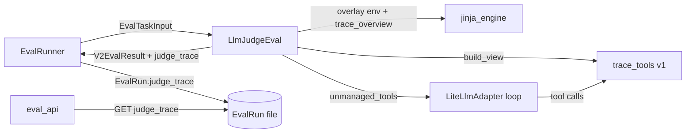

# Architecture: Agentic Eval

Implements [functional_spec.md](functional_spec.md). The exact behavior of trace toolset v1 (formats, algorithms, descriptions, schemas, error text) is in [components/trace_tools_v1.md](components/trace_tools_v1.md).

## 1. Decisions

| Decision | Choice | Why |
|----------|--------|-----|
| Judge type | **Option on the LLM judge** (`LlmJudgeProperties.trace_tools`), not a new `V2EvalType` | One judge with a capability. Everything an LLM judge has (prompt, model, run settings, judge traces, default prompt builder, UI form) is shared, not copied. Incompatible combinations are validation errors. |
| Where the trace tools live | `libs/core/kiln_ai/adapters/eval/trace_tools/`, one self-contained subpackage per toolset version (`v1/`) | Only judges use them. A frozen version must not share code that could change under it. |
| How `trace_overview` reaches templates | `utils/jinja_engine` registers a **placeholder** filter; the LLM judge renders through an **overlay environment** that binds the real, version-specific filter | `utils/` must not import `adapters/` (layering rule). Templates still compile everywhere (Jinja rejects unknown filters at compile time). |
| Judge trace storage | New field `EvalRun.judge_trace`, typed like `TaskRun.trace` | User decision: the judge trace belongs to the score record. Storage cost accepted. |
| Judge trace in the results list | Stripped from rows; fetched by a new per-result endpoint | Results rows already inline the judged trace. Adding judge traces to every row would double a large payload. |
| Bad tool arguments | Fixed in the model adapter by a **separate task** (argument errors become tool errors returned to the model) | A general adapter bug, not specific to this project. Prerequisite for agentic judges being robust. |
| Structured output with tools | Keep the LLM judge's current mode selection. Verified with real providers in a late implementation phase | User decision. Expected to work; if not, that phase brings options (per-model mode, new model-list field, litellm upgrade). |
| Eval builder | No support in v1 | User decision. |
| CPU-heavy work | `asyncio.to_thread` | Parsing and searching a 20 MB trace must not block the event loop, which runs up to 25 judgments at once. |

## 2. Data Model Changes

### 2.1 `TraceToolsetVersion` (`datamodel/eval.py`)

```python
class TraceToolsetVersion(str, Enum):
    v1 = "v1"

LATEST_TRACE_TOOLSET_VERSION = TraceToolsetVersion.v1
```

### 2.2 `LlmJudgeProperties` (`datamodel/eval.py`)

Two new fields:

```python
trace_tools: bool = Field(
    default=False,
    description="Give the judge model read-only tools to read the judged trace, instead of (or as well as) placing it in the prompt.",
)
trace_toolset_version: TraceToolsetVersion = Field(
    default=LATEST_TRACE_TOOLSET_VERSION,
    description="Locks the behavior of the trace tools and of the trace_overview template filter for this judge.",
)
```

- **Why the version is always set, even with tools off:** it also locks `{{ trace | trace_overview }}` (functional spec §5.4). `save_to_file` serializes defaults, so every judge saved from now on records its version explicitly. Judges saved before this field existed load with the latest version. That is harmless, because their templates predate the filter and they cannot have tools on.
- **New model validator:** `g_eval and trace_tools` raises `ValueError("G-Eval scoring can't be combined with trace tools.")`.
- **`EvalConfig.validate_v2_templates_and_expressions`:** the "must reference `final_message`, `trace` or `task_input`" rule applies only when `trace_tools` is False.

### 2.3 `EvalRun.judge_trace` (`datamodel/eval.py`)

```python
judge_trace: list[ChatCompletionMessageParam] | None = Field(
    default=None,
    description="The judge's own message history for this judgment: system prompt, rendered prompt, tool calls and results, and final answer. None for non-LLM judges, judgments skipped before the judge model was called, and records that predate this field.",
)
```

- Add a `model_validator(mode="after")` that calls `materialize_lazy_content(self.judge_trace)`, same as `TaskRun` (`datamodel/task_run.py:145`). Without it, list-typed `content` serializes once and then as `[]`.
- Not in `LEGACY_TRACE_FIELDS`. It is not a copy of the scored trace, so `validate_record_mode` allows it on pointer records.

### 2.4 `V2EvalResult` (`datamodel/eval.py`)

```python
judge_trace: list[ChatCompletionMessageParam] | None = None
```

## 3. Components



### 3.1 Trace tools package

```
libs/core/kiln_ai/adapters/eval/trace_tools/
  __init__.py        # public API: trace_toolset(), TraceToolset, judge_template_env()
  toolset.py         # TraceToolset protocol + trace_toolset(version) dispatch
  v1/
    __init__.py      # TOOLSET_V1: TraceToolset
    view.py          # TraceView, MessageView, ToolCallRef: parse + canonicalize once
    render.py        # overview, preview lines, read blocks, windows, refusals
    search.py        # matching with regex timeout
    tools.py         # the five UnmanagedKilnTool subclasses + build_tools()
    definitions.py   # tool names, descriptions, JSON schemas (frozen text)
    limits.py        # numeric limits (frozen)
    conftest.py      # --update-trace-tool-goldens option
    golden/          # fixture traces, cases, expected outputs
    test_*.py
```

**Protocol** (`toolset.py`):

```python
class TraceToolset(Protocol):
    version: TraceToolsetVersion
    def build_view(self, trace: Sequence[Mapping[str, Any]]) -> "TraceViewProtocol": ...
    def render_overview(self, view: "TraceViewProtocol") -> str: ...
    def build_tools(self, view: "TraceViewProtocol") -> list[KilnToolInterface]: ...

def trace_toolset(version: TraceToolsetVersion) -> TraceToolset:
    match version:
        case TraceToolsetVersion.v1:
            from kiln_ai.adapters.eval.trace_tools.v1 import TOOLSET_V1
            return TOOLSET_V1
        case _:
            raise_exhaustive_enum_error(version)
```

- `TOOLSET_V1` is a stateless, immutable instance. No module-level mutable state.
- The view type is opaque outside a version: each version owns its canonicalization, because canonical text determines sizes, offsets and search positions, and those are locked per version.

**Freezing v1.** Nothing under `v1/` imports from another version or from shared trace-tools code that could change. It may import only stable primitives: `open_ai_types` constants, `UnmanagedKilnTool`, `ToolCallResult`, `build_kiln_unmanaged_tool_id`, `regex`. Golden tests (§7.2) fail on any output change. A v2 starts as a copy of `v1/`.

### 3.2 `TraceView` (v1)

Built once per judgment, in a worker thread:

```python
@dataclass(frozen=True)
class ToolCallRef:
    name: str
    arguments: str              # canonical (see component doc)
    call_id: str | None
    result_number: int | None   # message number of its tool result, if any

@dataclass(frozen=True)
class MessageView:
    number: int                 # 1-based
    role: str                   # system | developer | user | assistant | tool (function -> tool)
    content: str                # canonical text, "" if none
    reasoning: str
    tool_calls_text: str        # canonical "name {args}" lines, task_response excluded
    tool_calls: tuple[ToolCallRef, ...]
    tool_name: str | None       # tool results: name of the call it answers ("unknown tool" if unresolved)
    is_error: bool              # tool results marked is_error

@dataclass(frozen=True)
class TraceView:
    messages: tuple[MessageView, ...]
    def message(self, number: int) -> MessageView: ...
    def part_text(self, number: int, part: Part) -> str: ...
```

- **Two passes, O(total chars).** Pass 1 canonicalizes every message and indexes calls by `id`. Pass 2 resolves each tool result's name and sets the matching call's `result_number`; the first result for a call id wins.
- This replaces the O(n²) name lookup in `EvalTraceFormatter`.
- **Accepts loose dicts.** `EvalTaskInput.trace` is `list[dict]`, so the view accepts loose dicts and never raises on odd shapes. A missing role becomes `"unknown"`. Non-string content falls back to the component doc's rules.
- Canonicalization rules are in the [component doc §2](components/trace_tools_v1.md#2-canonical-text).

### 3.3 Tools (v1)

- **One subclass per tool.** Five subclasses of a shared `_TraceTool(UnmanagedKilnTool)`. Each takes a `TraceView` in its constructor. Tool ids are `build_kiln_unmanaged_tool_id("trace_v1_<name>")`.
- **What `_TraceTool.run(context, **kwargs)` does:**
  1. Re-validates `kwargs` against the tool's JSON schema. This is defensive: it covers SDK callers, and runs before the adapter fix lands.
  2. Applies defaults.
  3. Runs the tool's pure function `execute(view, args) -> str`. `search_trace` and `read_messages` run in `asyncio.to_thread`. The others are cheap and run inline.
  4. Returns `ToolCallResult(output=text)`.
- **Errors never fail the judgment:**
  - `TraceToolUsageError` (a judge mistake, or a refused oversized response) becomes `ToolCallResult(output=message, is_error=True, error_message=message)`.
  - Any other exception is logged with `logger.exception` and returned as `is_error=True` with `"Internal error in <tool>; try different arguments."`. This keeps the functional spec's promise that a tool never fails the judgment, while bugs stay visible in logs.
  - Trace content is never logged.
- **`build_tools(view)`** returns the five tools in a fixed order: `trace_overview`, `preview_messages`, `read_messages`, `read_message_text`, `search_trace`.

### 3.4 Search (v1)

- **Engine.** Uses the `regex` package (already a `kiln_ai` dependency) for its `timeout=` support:
  - literal mode compiles `regex.escape(pattern)`;
  - matching is case-insensitive by default (`regex.IGNORECASE`), with no full case folding, so offsets stay exact.
- **Time limit.** One 30-second deadline per call. Each `finditer` gets the remaining time, and a `TimeoutError` becomes a usage error.
- **Counting.** Matches are counted in full, for the "N matches in K messages" line. Only the page `[offset, offset+count)` is rendered.
- Details are in the [component doc §6](components/trace_tools_v1.md#6-search_trace).

### 3.5 Response size limit

Implemented once in `render.py`:

```python
@dataclass(frozen=True)
class Unit:            # one line or block of a response
    message_number: int
    text: str

def assemble(units, header, footer, limit, refusal: RefusalContext) -> str  # raises TraceToolUsageError
```

- `assemble` joins the units. If the result exceeds `LIMIT_RESPONSE_CHARS = 40_000`, it computes the longest prefix of units that fits and raises a refusal naming that range, using the tool-specific advice in `RefusalContext`.
- **Which tools it applies to:** `preview_messages`, `read_messages` and `search_trace`. `read_message_text` is bounded by `max_chars ≤ 40,000` plus a fixed-size header. `trace_overview` is bounded by construction.

### 3.6 `trace_overview` in templates

- **`utils/jinja_engine.py`** registers a placeholder in `_template_env`:

  ```python
  def _trace_overview_placeholder(value: Any) -> str:
      raise JinjaExtractionError("trace_overview is only available in LLM judge prompt templates.")
  _template_env.filters["trace_overview"] = _trace_overview_placeholder
  ```

  Templates that use it then compile in datamodel validation, and in any other environment it fails clearly.
- **`trace_tools/__init__.py`** provides the judge's environment:

  ```python
  def judge_template_env(toolset: TraceToolset, trace: list[dict[str, Any]] | None, view: TraceViewProtocol | None) -> SandboxedEnvironment:
      env = _template_env.overlay()
      # overlay() shares the parent's filters dict by reference; assign a new dict
      # so the parent's placeholder is never replaced.
      env.filters = {**_template_env.filters, "trace_overview": _overview_filter(toolset, trace, view)}
      return env
  ```

- **How the filter gets its view.** `_overview_filter` returns a closure. If called with the judge's own `trace` list (identity check), it reuses the prebuilt `view`. If none was built, because tools are off, it builds one on first use and keeps it in the closure. Any other value must be a list of dicts, or it raises `JinjaExtractionError`, which becomes the existing `extraction_failed` skip. A new environment per judgment means no module-level cache.

### 3.7 `LlmJudgeEval.evaluate` (`adapters/eval/v2_eval_llm_judge.py`)

New flow (unchanged steps elided):

1. Reference-key checks: unchanged.
2. **If `trace_tools` is on and `eval_input.trace` is empty or None:** return a `missing_trace` skip.
3. `namespace = eval_input.model_dump()` plus `judge_instructions`: unchanged.
4. `toolset = trace_toolset(props.trace_toolset_version)`.
5. **If `trace_tools`:** `view = await asyncio.to_thread(toolset.build_view, namespace["trace"])`. Otherwise `view = None`.
6. Render with `judge_template_env(toolset, namespace["trace"], view)`, with the existing error-to-skip mapping. `_unknown_template_variables` keeps parsing with `_template_env`.
7. Build the judge task, structured output mode and run config: unchanged.
8. `AdapterConfig(allow_saving=False, top_logprobs=..., unmanaged_tools=toolset.build_tools(view) if trace_tools else None, automatic_prompt_caching=props.trace_tools)`. Prompt caching only changes cost, and long tool loops resend a growing prefix.
9. Invoke, mapping one specific failure:

   ```python
   try:
       judge_run, run_output = await adapter.invoke_returning_run_output(rendered_prompt)
   except KilnRunError as e:
       if isinstance(e.original, litellm.ContextWindowExceededError):
           raise JudgeContextExceededError.from_run_error(e) from e
       raise
   ```

10. Return `V2EvalResult(scores, intermediate_outputs, usage=judge_run.usage, judge_trace=judge_run.trace)`. This covers all modes: classic, G-Eval and trace tools.

- **`JudgeContextExceededError(Exception)`** is defined in `adapters/eval/eval_utils/errors.py`, a new module. Its message is: `"The judge model ran out of context after {n} trace tool calls. Use a judge model with a larger context window, or a prompt that needs less of the trace."` Here `n` is the number of tool messages in `e.partial_trace`. It is not in `is_retryable_error`, so the runner does not retry it, and the test endpoints return its message.

### 3.8 Default prompt and properties builder (`adapters/eval/base_eval.py`)

- **`build_default_llm_judge_prompt(eval, trace_tools: bool = False)`.** With `trace_tools`, the guard line and data blocks are replaced by the functional spec §5.3 block:
  - the guard line naming the trace overview and tool results;
  - `<trace_overview>\n{{ trace | trace_overview }}\n</trace_overview>`;
  - `Use the trace tools to inspect the parts of the trace you need.`

  The task description, reference answer block, steps and score criteria logic are unchanged.
- **`materialize_llm_judge_properties(..., trace_tools: bool = False)`.** Passes `trace_tools` to the default prompt builder and to `LlmJudgeProperties`. The version takes the default, which is the latest. The G-Eval conflict is caught by the properties validator, which the endpoint maps to 422.

### 3.9 Eval runner (`adapters/eval/eval_runner.py`)

- `_persist_score(..., judge_trace: list[ChatCompletionMessageParam] | None = None)` passes it to `EvalRun`.
- `_persist_judgment` passes `result.judge_trace`.
- Nothing else changes: errors and retries behave as today.

### 3.10 API (`app/desktop/studio_server/eval_api.py`)

| Change | Detail |
|--------|--------|
| `LlmJudgeBuilderInput.trace_tools: bool = False` | Used by `create_llm_judge_config` and `test_v2_eval`; passed to `materialize_llm_judge_properties`. |
| `GET .../default_llm_judge_prompt?trace_tools=<bool>` | Default `false`. Returns the agentic default when `true`. |
| `TestV2EvalResponse.judge_trace: list[ChatCompletionMessageParam] \| None` | Set from `result.judge_trace` in `run_v2_eval_test`. |
| `TestV2EvalResponse` errors | `JudgeContextExceededError` maps to HTTP 422 with its message. Other errors are unchanged. |
| `EvalRunWithTrace` | Rows carry `eval_run.model_copy(update={"judge_trace": None})` and a new `has_judge_trace: bool`, in both `from_own_fields` and `from_scored_run`. |
| New `GET /api/projects/{project_id}/tasks/{task_id}/evals/{eval_id}/eval_config/{eval_config_id}/eval_run/{eval_run_id}/judge_trace` | Returns `JudgeTraceResponse { judge_trace: list[ChatCompletionMessageParam] \| None }`. Loads the EvalRun with `EvalRun.from_id_and_parent_path`. 404 if not found. `ALLOW_AGENT` like its siblings. |
| `prompt_optimization_job_api.optimization_unsupported_reason` | An `LlmJudgeProperties` with `trace_tools=True` returns `"Prompt optimization doesn't support LLM judges with trace tools."` |
| OpenAPI client | Regenerate with `app/web_ui/src/lib/generate_schema.sh`. |

These handlers stay thin: parse, call one core function, map the result (convention E16).

### 3.11 Web UI

Specified in the UI design step, which comes after this architecture, along with the open template-default question. Known touch points:

- **Judge form** (`llm_judge_form.svelte`, `eval_config_builder.svelte`):
  - a trace tools option, which disables G-Eval;
  - `requires_tool_support` on the model dropdown when on;
  - `trace_tools` sent on test and save;
  - the default prompt fetched with `trace_tools`.
- **Test pane** (`eval_test_run_pane.svelte`): show the judge trace with `ChatTrace`.
- **Results** (`run_result/+page.svelte`, `llm_judge_result.svelte`): a "Judge trace" action when `has_judge_trace`, fetching from the new endpoint into the existing trace dialog.
- **Judge display** (`eval_config_instruction.svelte`): show "Trace tools: on (v1)".

## 4. Prerequisite: Non-Fatal Tool Argument Errors

This is a separate task, already queued. `LiteLlmAdapter.process_tool_calls` will return argument errors (unknown tool, non-JSON arguments, schema mismatch) to the model as error tool messages, instead of raising.

- **Before it lands:** trace tools still work, but one malformed call fails the judgment.
- **Required before:** the provider-verification phase. It is not required before the core phases.

## 5. Error Handling

| Failure | Where it's handled | Result |
|---------|--------------------|--------|
| Bad arguments that still match the schema (start > end, number out of range, offset past end, both `numbers` and `start`/`end`) | `_TraceTool.run` raises `TraceToolUsageError` | Error tool result. The judgment continues. |
| Response over 40k | `render.assemble` | Refusal tool result with the fitting range. |
| Regex invalid or timed out | `search.py` | Error tool result. |
| Unexpected exception inside a tool | `_TraceTool.run` | Logged, then a generic error tool result. |
| Missing or empty trace with tools on | `LlmJudgeEval.evaluate` | `missing_trace` skip. |
| Template render problems, including the `trace_overview` misuse | Existing mapping | `extraction_failed` or `missing_reference_key` skip. |
| Judge context overflow | `LlmJudgeEval.evaluate` | `JudgeContextExceededError`. Not retried. Nothing saved. |
| Tool round limit (`MAX_TOOL_CALLS_PER_TURN`) | Adapter `RuntimeError` | Not retried. Nothing saved. |
| G-Eval with trace tools | `LlmJudgeProperties` validator | `ValueError`, which the API turns into a 422. |
| Transient provider errors | Runner, as today | Retried. |

## 6. Performance

- **Target trace size:** traces up to 5M tokens, about 20 MB of text.
- **`build_view`:** one pass, run in a thread. Target: under 2 s for 20 MB.
- **Every tool except `search_trace`:** O(selected messages) using the prebuilt view. Target: under 200 ms on a 20 MB trace.
- **`search_trace`:** a linear scan with a 30 s limit, run in a thread.
- **Memory:** the view holds a second copy of the trace's text (about 2× trace size per running judgment). This is acceptable at the runner's concurrency of 25.

## 7. Testing Strategy

Read `python_test_guide.md` before writing tests. Everything is pytest, and the CPU-heavy pieces get benchmark tests.

### 7.1 Unit tests: `v1/` (pure functions over `TraceView`)

- **Canonicalization.** The fixture traces cover:
  - string and list content;
  - images, audio and file parts;
  - Kiln task-tool JSON results;
  - `task_response` (alone, and with text);
  - assistant `refusal`;
  - legacy `function` messages and `developer` messages;
  - tool results whose call id doesn't resolve;
  - calls with no result, and two results for one call id;
  - non-JSON tool arguments;
  - missing roles and loose dicts.
- **Each tool:**
  - defaults;
  - every parameter;
  - every error message in the component doc's catalog;
  - the boundaries: `start == end`, the last message, `offset` at the end of a part, `preview_chars=0`, `max_chars=40000`.
- **Selection rule.** A message is picked only if it has a requested part, and the "Not shown" footer appears.
- **Refusal.** A response just under and just over 40k. The fitting range is correct. A single message alone is too big.
- **Search:**
  - literal vs regex;
  - case sensitivity;
  - context snippets at part edges;
  - paging with `count` and `offset`;
  - zero-length matches skipped;
  - invalid regex;
  - timeout, forced with a catastrophic pattern and a small injected deadline;
  - `offset` past the last match.

### 7.2 Golden tests: freezing v1

- **Cases.** `golden/cases.json` lists `(fixture trace, tool, arguments)` cases. Each has an expected output file under `golden/expected/`. Also frozen: the tool definitions (names, descriptions, schemas) and the overview filter output.
- **Updating.** `uv run pytest libs/core/kiln_ai/adapters/eval/trace_tools/v1 --update-trace-tool-goldens` rewrites the expected files. Changing them must be a deliberate, reviewed act.
- **Fixtures.** Handcrafted fixtures cover the edge cases. A seeded synthetic generator produces a realistic coding-agent trace of about 1,300 messages.

### 7.3 Performance

- `pytest-benchmark` tests, on a seeded synthetic 20 MB trace, for:
  - `build_view`;
  - `preview_messages(preview_chars=0)` over the whole trace (refused);
  - a literal search.
- Asserted bounds match §6, with generous slack for CI.

### 7.4 Judge integration (`test_v2_eval_llm_judge.py`, mocked adapter)

- **Tools on:**
  - `unmanaged_tools` holds the five v1 tools;
  - prompt caching is on;
  - `judge_trace` is returned.
- **Tools off:**
  - no tools;
  - `judge_trace` is still returned (the classic and G-Eval paths).
- **Skips:**
  - missing or empty trace with tools on gives `missing_trace`;
  - `trace_overview` in a tools-off template renders the overview;
  - the placeholder filter outside judges raises.
- **Version lock:** the filter output follows `trace_toolset_version`, by registering a fake v2 in the test only.
- **Errors:** `ContextWindowExceededError` wrapped in `KilnRunError` gives `JudgeContextExceededError`, and it is not retryable.

### 7.5 Datamodel

- **G-Eval conflict:** G-Eval with trace tools is rejected.
- **Template rule:** relaxed when tools are on, unchanged when off.
- **Version on disk:** `trace_toolset_version` round-trips, and old files load.
- **`EvalRun.judge_trace`:** round-trips with list content (the `materialize_lazy_content` regression), and is allowed on pointer records.

### 7.6 Runner

`judge_trace` is saved on the EvalRun for scored judgments, and absent for skips.

### 7.7 API

- **Judge creation:** create, and test with `trace_tools`. G-Eval with trace tools returns 422.
- **Default prompt:** `default_llm_judge_prompt?trace_tools=true` contains the overview block.
- **Judge traces:** result rows strip `judge_trace` and set `has_judge_trace`. The judge-trace endpoint returns it, and returns 404 for an unknown id.
- **Prompt optimization:** rejects an LLM judge with trace tools on.
- **Context overflow:** a test run returns 422 with the message.

### 7.8 Real providers (late phase, paid)

A paid test (`@pytest.mark.paid`) runs an agentic judge end to end on a fixture trace with a small set of OpenRouter models. It checks two things:

1. The judge calls at least one trace tool before answering.
2. It returns schema-valid scores.

This is the check for the structured-output-with-tools question in §1.

## 8. Risks

| Risk | Mitigation |
|------|------------|
| Providers or litellm force the structured-output answer when tools are present (e.g. litellm's Anthropic path for models without native structured output), so the judge answers without reading | §7.8 detects it ("called at least one tool"). Options are decided then. |
| Tool schema bounds (`minimum`/`maximum`) rejected by some providers in tool definitions | Covered by §7.8. Fallback: drop the bounds from the schema, which a new toolset version would do. The tools still validate internally. |
| Judge trace storage grows git-synced projects | Accepted (user decision). |
| Overlay environment accidentally mutating the shared filters dict | A new dict is assigned (§3.6), and a test asserts the base env's filter is still the placeholder after a judge render. |
