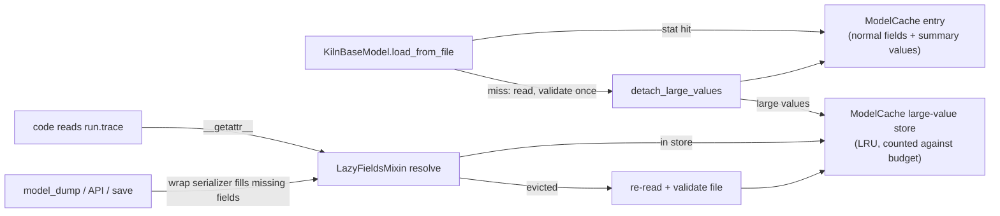

# Architecture: Cache Eviction and Efficiency

This doc covers the overall design, the smaller changes, and how the parts fit together. Two components have their own detailed docs:

- [`components/lazy_fields.md`](components/lazy_fields.md): marking large fields, removing them from cached records, restoring them, and keeping serialization, copies and the API schema correct.
- [`components/model_cache.md`](components/model_cache.md): the cache itself. Entries, change detection, the memory budget, eviction, the on/off switch, and thread safety.

Read the [functional spec](functional_spec.md) first. This doc does not repeat its requirements.

## Overview



Data path for a readonly load with the cache on:

1. `load_from_file(path, readonly=True)` asks the cache. On a hit (same file identity), it returns the cached record, as today.
2. On a miss, it reads the file and validates it **once** (change 5a), with `parent` and `path` included in the validated data.
3. If the class uses `LazyFieldsMixin`, `detach_large_values` computes the summary values, removes the large values from the record, and hands them to the cache along with a size estimate.
4. The cache stores the record (its normal part) and the large values as two separately counted, separately evicted pieces.
5. Later, reading a large field on the record goes through `__getattr__`. It gets the value from the cache's store, or re-reads the file if the value was evicted.

When the cache is off (the library default), step 3 never runs. Every load returns a complete, ordinary model.

## Modules and files

| File | Change |
|---|---|
| `libs/core/kiln_ai/datamodel/lazy_fields.py` | **New.** `LargeField`, `summary_value`, `LazyFieldsMixin`, `LargeFieldUnavailableError`, `detach_large_values`, `approx_value_size`, and the internal per-record lazy state. See the component doc. |
| `libs/core/kiln_ai/datamodel/model_cache.py` | **Rewritten.** `FileIdentity`, the LRU entries and large-value store, the budget, `set_model_cache_enabled` / `model_cache_enabled`, and RAM detection. The broken Linux check is removed. See the component doc. |
| `libs/core/kiln_ai/datamodel/basemodel.py` | `load_from_file` validates once and calls `detach_large_values` before caching. A new `_validate_file_data` classmethod is shared by load and restore. `mutable_copy` rebuilds from disk when a lazy record's file has changed. |
| `libs/core/kiln_ai/datamodel/task_run.py` | `TaskRun` gains `LazyFieldsMixin`, markers, and four summary values. `has_thinking_training_data` uses the summary value. |
| `libs/core/kiln_ai/datamodel/task_output.py` | `TaskOutput` gains `LazyFieldsMixin`, and `output` is marked. |
| `libs/core/kiln_ai/datamodel/eval.py` | `EvalRun` gains `LazyFieldsMixin`, markers, and `judge_trace_length`. The `Eval` current-config migration switches from `self._loaded_from_file` to `self.loaded_from_file(info)` (see 5a). |
| `libs/core/kiln_ai/datamodel/embedding.py` | `ChunkEmbeddings` gains `LazyFieldsMixin`, and `embeddings` is marked. |
| `libs/core/kiln_ai/datamodel/world.py` | `WorldEpisode` (a plain `BaseModel`) gains `LazyFieldsMixin`, `final_state` is marked, and it gets a `has_final_state` summary value. |
| `libs/core/kiln_ai/datamodel/__init__.py` | Re-exports `set_model_cache_enabled` and `model_cache_enabled`. |
| `libs/server/kiln_server/run_api.py` | `RunSummary.from_run` and `repair_status_display_name` use the summary values. `/chain` uses `trace_length`. |
| `app/desktop/studio_server/eval_api.py` | `_split_judge_trace` uses `judge_trace_length`. Score-summary functions are reviewed (5d). `eval_configs_score_summary` loads runs readonly (5b). |
| `libs/core/kiln_ai/adapters/eval/trace_index.py` | The "unfinished world episode" check uses `has_final_state`. |
| Bulk callers in 5b | `readonly=True` where the caller doesn't edit. |
| `app/desktop/desktop_server.py` | The lifespan turns the cache on and restores the previous setting on shutdown, the same way it handles strict mode. |
| `libs/server/kiln_server/server.py` | `make_app` installs a default lifespan that turns the cache on, used when the caller passes no lifespan. |
| `libs/server/kiln_server/mcp/mcp.py` | `main()` turns the cache on before serving. |
| `.github/workflows/build_and_test.yml` | A macOS and Windows test job, triggered on release and by hand. |
| `app/web_ui/src/lib/utils/task_sample_example.ts` | The add-example dialog fix (5c). **Pending a decision**, see 5c. |
| `conftest.py` (repo root) | A `model_cache_enabled` fixture. The default test state is the library default (off). |

## Public interfaces

The full signatures are in the component docs. Summary:

```python
# kiln_ai.datamodel.model_cache (re-exported from kiln_ai.datamodel)
def set_model_cache_enabled(value: bool) -> None: ...
def model_cache_enabled() -> bool: ...

# kiln_ai.datamodel.lazy_fields
class LargeField: ...                      # Annotated marker
class LazyFieldsMixin(BaseModel): ...      # opt-in base for classes with large fields
def summary_value(fn) -> SummaryValue: ... # read-only, typed descriptor
class LargeFieldUnavailableError(RuntimeError): ...
```

How a model declares lazy fields:

```python
class TaskRun(LazyFieldsMixin, KilnParentedModel, KilnParentModel, parent_of={...}):
    input: Annotated[str, LargeField()] = Field(description="...")
    trace: Annotated[list[ChatCompletionMessageParam] | None, LargeField()] = Field(default=None, ...)

    @summary_value
    def trace_length(self) -> int:
        return len(self.trace) if self.trace else 0
```

`LazyFieldsMixin` goes **first** in the bases. That puts its `__getattr__`, `__deepcopy__`, `__eq__` and serializer ahead of `KilnBaseModel`'s in the method resolution order.

### Why an opt-in base, not all of `KilnBaseModel`

Lazy fields need a wrap `model_serializer` and a JSON-schema override (see the component doc). Putting them on `KilnBaseModel` would run a Python serializer for every model in the datamodel, and would route the OpenAPI schema of every model through the override. With an opt-in base, five classes change: `TaskRun`, `TaskOutput`, `EvalRun`, `ChunkEmbeddings` and `WorldEpisode`. The cost is one extra base class on each.

A check stops the base being forgotten: `KilnBaseModel.__pydantic_init_subclass__` raises `TypeError` at import if a class declares a `LargeField` but doesn't inherit `LazyFieldsMixin`. For plain `BaseModel` classes, which `KilnBaseModel` can't hook, a test walks every model class in `kiln_ai.datamodel` and asserts the same rule.

## The smaller changes

### 5a. Validate once per load

`load_from_file` today runs `model_validate`, then assigns `parent` and `path`. Each assignment re-runs every model validator (`validate_assignment=True`).

New flow, in a classmethod shared with restore:

```python
@classmethod
def _validate_file_data(cls, raw: dict[str, Any], path: Path, parent: KilnBaseModel | None) -> Self:
    data = dict(raw)
    data["path"] = path
    if parent is not None:
        data["parent"] = parent
    m = cls.model_validate(data, context={"loading_from_file": True, "source_dir": path.parent})
    m._loaded_from_file = True
    return m
```

- **Why the parent is accepted as-is.** `parent` is `Optional[KilnBaseModel]` with `exclude=True`. Pydantic accepts an existing instance without re-validating it, because the default is `revalidate_instances="never"`.
- **What validators see.** They now get `parent` and `path` during the single pass, with the loading context set. The checks on `model_type` and `v` (schema version) are unchanged and still run on `raw`.
- **The one known behavior trap.** The `Eval` validator that sets `current_config_id` (`eval.py`, about line 1696) reads `self._loaded_from_file` directly. That flag is only `True` on today's re-runs, so with one pass the migration would never run. It switches to `self.loaded_from_file(info)`, which reads the loading context. The implementer greps `libs/core/kiln_ai/datamodel` for `_loaded_from_file` and for validators that read `self.parent` or `self.path`. Each one is checked against the characterization test below.
- **Characterization test.** It covers every `.kiln` file in `.agents/playwright_project/` and in the datamodel test fixtures. For each file, it loads with the old procedure (validate, then assign `parent`, then `path`; re-implemented inside the test) and with the new one. It asserts the `model_dump()` output is equal and any exception type is the same. It also covers an `Eval` that needs the `current_config_id` migration.

### 5b. Bulk callers that don't edit use readonly loads

Switch to `readonly=True` after confirming the caller never assigns to, saves, or passes on a run for editing:

- `libs/core/kiln_ai/datamodel/dataset_split.py`: the run loads in split creation (about line 146) and in `missing_count`.
- `app/desktop/studio_server/eval_api.py`: `eval_configs_score_summary` (`task.runs()` at about line 3346).
- `app/desktop/studio_server/utils/copilot_utils.py`: the run loads at about lines 650, 686, 758 and 781. These are the `spec_with_copilot` flow and the eval builder pipelines.
- `app/desktop/studio_server/eval_builder_api.py`: `judge_traces` (`from_ids`, about line 849) reads traces only.

**Procedure.** For each `task.runs(`, `.runs(readonly=False`, `all_children_of_parent_path(` and `from_ids_and_parent_path(` call in `libs/` and `app/desktop/` outside tests, the implementer records one of two outcomes in the phase plan. Either "switched", or "kept mutable" with the reason (for example "edits tags" or "export needs full records for the split only").

**Kept mutable:** `edit_tags`, which edits selected runs; the JSONL export in `dataset_formatter.py`, which needs full records but only for the split's ids; and any caller that saves.

### 5c. Add-example dialog (pending decision)

`fetch_task_sample_candidates` (`task_sample_example.ts`) has four callers: `add_example_dialog.svelte`, `task_sample_selector.svelte`, the spec builder page, and `existing_run_picker_dialog.svelte`. It calls `GET /runs` with no limit.

The picker (`task_run_picker.svelte`) shows each run's full input and output, with a "see all" view, and pages through the list in the browser. The light `runs_summaries` endpoint only has 100-character previews, so it can't feed the picker as it stands.

- **Option A (recommended): cap the request.** Call `GET /runs?limit=250`. The endpoint already returns the newest runs first, and under lazy loading only those 250 load their large fields. The change is one line plus tests. What users see changes slightly: the picker lists only the 250 newest runs, and the five-star auto-select looks only within those.
- **Option B: summaries plus a full fetch per page.** Pick from `runs_summaries`, then fetch full runs only for the picker's visible page and the auto-selected run. Nothing visible changes. It touches the picker, its paging, the four callers, and needs a "get runs by ids" call.

If Option A is chosen, the functional spec's line "What the user sees must not change" is updated to describe the cap.

### 5d. Eval score pages

With `EvalRun`'s large fields marked, score aggregates stop holding traces automatically. The implementer reviews these functions and confirms each reads only normal fields or summary values:
- the score summary builders in `eval_api.py` (about lines 1193, 1406, 1950 and 3367);
- `eval_input_references` (about line 256);
- the eval worker's `compute_state` (`jobs/workers/eval.py`, about line 480);
- `scored_trace_usage_for_run_configs`.

Any that reads a large field only to test whether it's set switches to a summary value. That means adding one to `EvalRun` if needed, using the `judge_trace_length` pattern.

### Turning the cache on in each host

| Host | Where | How |
|---|---|---|
| Desktop app and dev server | `desktop_server.lifespan` | Save `model_cache_enabled()`, call `set_model_cache_enabled(True)`, and restore the saved value in `finally`. This is the same pattern as strict mode. |
| `kiln_server` | `kiln_server.server.make_app` | When `lifespan is None`, use a default lifespan that does the same. The desktop app passes its own lifespan, so the default never runs there. |
| `kiln_mcp` | `kiln_server.mcp.mcp.main` | Call `set_model_cache_enabled(True)` before serving. It's a process entry point. |

Nothing turns the cache on at import. The process-wide `ModelCache.shared()` singleton stays. It is an existing global, and it follows the same documented pattern as `set_strict_mode`: off in the library, switched on by hosts. Replacing it with an injected cache would touch every datamodel load call, which is out of scope.

### CI: macOS and Windows on release

In `.github/workflows/build_and_test.yml`:
- **Triggers:** add `release: types: [created]` and `workflow_dispatch` to `on:`.
- **The existing `build` job:** gains `if: github.event_name != 'release'`. The release's commit was already tested on Ubuntu when it was pushed.
- **New job `test_macos_windows`**, with `if: github.event_name == 'release' || github.event_name == 'workflow_dispatch'`. Its settings:
  - matrix `os: [macos-latest, windows-latest]`, with `fail-fast: false`;
  - `defaults.run.shell: bash`;
  - `env: UV_PYTHON: "3.13"`.
- **Its steps** match `build`'s install and mock-web-UI steps, then run `uv run python -m pytest --runslow .`. It has no type check and no package builds.
- The existing Windows path-handling job doesn't change.

## Error handling

- **A large field that can't be restored** raises `LargeFieldUnavailableError`, a `RuntimeError` subclass. The message names the file path, the field, and the cause: missing file, unreadable file, failed validation, or the record's shape changed on disk. The original exception is chained. It never falls back to `None` or empty values.
- **Load errors are unchanged.** Wrong `model_type`, a newer schema version and validation failures raise the same exceptions as today (enforced by the 5a characterization test).
- **Cache bookkeeping never raises into callers.** For example, a failed stat during a hit check is treated as a miss, as today.
- **Logging** uses the module logger `kiln_ai.datamodel.model_cache` at debug level for evictions, for restores of evicted values, and for mixed old/new reads of a changed file. It never logs at info level or above on the hot path.

## Testing strategy

- **Framework:** pytest, with benchmarks through `pytest-benchmark`, as today. Tests sit next to the code: `test_lazy_fields.py` and `test_model_cache.py` in `libs/core/kiln_ai/datamodel/`.
- **Cache state in tests:** tests run with the library default (off). Tests that need the cache use a `model_cache_enabled` fixture from the root `conftest.py`. It gives a fresh `ModelCache` with a test budget, installs it as the shared instance, and restores the previous one afterwards. The `pytest.skip("Cache is disabled on this fs")` guards are removed.
- **Existing tests:** some may depend on the cache being on, for example `is` identity checks on readonly loads. They take the fixture; their assertions don't change.
- **Component test plans:** each component doc lists its test cases by name.
- **Integration:**
  - an API test calls `GET /runs`, `GET /runs/{id}` and `runs_summaries` on a cached task whose large values were evicted, and asserts the responses match a cache-off run;
  - a test saves a run loaded from an evicted cache and checks the file on disk is unchanged apart from the edit.
- **Schema:** `app/web_ui/src/lib/check_schema.sh` must show no diff. It catches any change to the OpenAPI output.
- **Benchmarks:**
  - the existing `test_benchmark_load_from_file` must not regress;
  - a new warm `task.runs(readonly=True)` benchmark must not regress;
  - a new memory benchmark loads 2,000 synthetic 20-turn runs with a 20 MB test budget, and asserts the cache's accounted total stays at or below budget and `tracemalloc`'s retained size is within 50% of it.
- **Platforms:** locally on Linux, plus the new macOS and Windows job, started by hand before merge.

## Implementation order (outline for the plan)

1. Change detection, the on/off switch, hosts, test fixture, CI job, and single-pass validation (5a).
2. Budget, LRU and whole-record eviction in `ModelCache`, with no lazy fields yet.
3. `lazy_fields.py` and the cache's large-value store.
4. Marking fields, summary values and consumer call sites, plus 5b and 5d.
5. The add-example dialog (5c).
6. Benchmarks, docs and a final cleanup.
