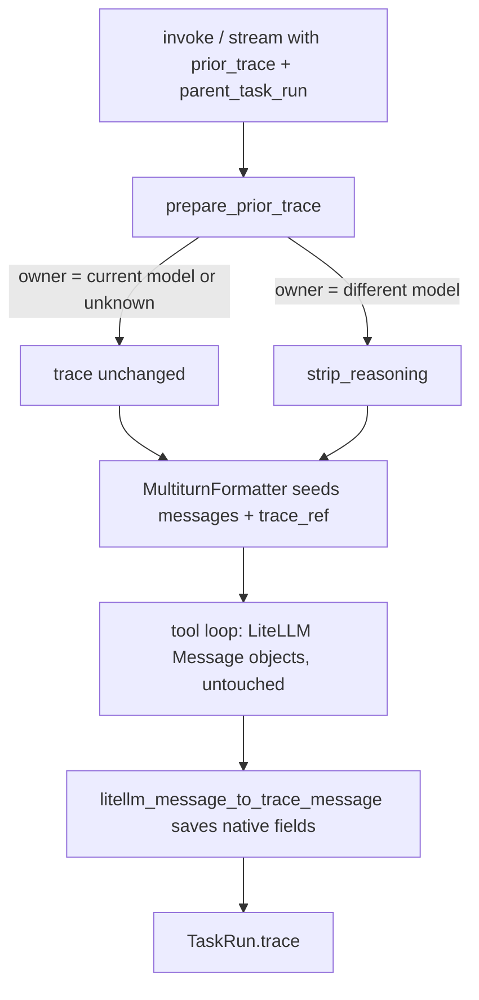

# Architecture: Improve Reasoning

This doc holds the shared design. Two component docs hold the detail:

- [components/providers.md](./components/providers.md): per-provider fixes. They are written once the provider verification run is in (`research/provider-verification/`).
- [components/tests.md](./components/tests.md): the offline and paid test suites.

## Principle

**Inside a run, LiteLLM owns the messages.** The tool loop keeps sending LiteLLM's own `Message` objects, untouched, as today. Single-turn tasks see no change.

**Across runs, the saved trace reproduces LiteLLM exactly.** Each assistant message is saved with exactly the fields LiteLLM sends to the provider for that message. Sending those fields back as plain JSON gives a byte-identical provider request for every provider ([offline probes](./research/litellm-replay/summary.md)). So a turn continued from disk sends what the in-memory loop would have sent, which is what prompt caching needs.

**Kiln deviates from LiteLLM only to fix an error a paid call confirms.** Each such fix is applied where the `Message` is built or sent, so it reaches the in-memory loop and saved traces alike. Each one is also reported upstream to LiteLLM and removed once LiteLLM ships a fix. The list lives in [components/providers.md](./components/providers.md).

## Data model

### Trace message fields

`ChatCompletionAssistantMessageParamWrapper` (`libs/core/kiln_ai/utils/open_ai_types.py`) gains three optional fields:

```python
thinking_blocks: Optional[List[Dict[str, Any]]]
"""LiteLLM's thinking blocks (Anthropic signed thinking and redacted thinking), saved as returned."""

reasoning_items: Optional[List[Dict[str, Any]]]
"""LiteLLM's OpenAI Responses reasoning items (id, encrypted_content, summary), saved as returned."""

provider_specific_fields: Optional[Dict[str, Any]]
"""LiteLLM's provider-specific message fields, saved as returned. Examples are Gemini thought_signatures and OpenRouter reasoning_details."""
```

- **Types are deliberately loose.** Today's trace validation drops any key a TypedDict doesn't declare, and LiteLLM's own TypedDicts also drop unknown nested keys and `None` values. `Dict[str, Any]` keeps everything, which exactness requires. Never type them `Iterable`: `materialize_lazy_content` only handles `content`.
- **Names match LiteLLM's**, so a saved message is a valid LiteLLM input message with no renaming.
- **These are not Kiln-only fields.** They are not added to `KILN_ONLY_MESSAGE_FIELDS`, because they must reach LiteLLM.
- **A new constant** lists every field that carries reasoning:

  ```python
  REASONING_MESSAGE_FIELDS: frozenset[str] = frozenset(
      {"reasoning_content", "thinking_blocks", "reasoning_items", "provider_specific_fields"}
  )
  ```

  It covers `provider_specific_fields` as a whole. That dict is provider-specific by definition, so it never belongs to another model.
- **Groq** may need a fourth field. The verification run will say whether non-streamed Groq reasoning must be saved as `reasoning`; see the providers component.

### Generated API types

`app/web_ui/src/lib/api_schema.d.ts` gains the three optional fields, regenerated with `app/web_ui/src/lib/generate_schema.sh`. The UI doesn't read them.

## Components

### 1. Saving: `LiteLlmAdapter.litellm_message_to_trace_message`

File: `libs/core/kiln_ai/adapters/model_adapters/litellm_adapter.py`.

Today this copies `content`, `reasoning_content` and rebuilt `tool_calls`. It gains a copy of the native fields:

```python
NATIVE_REASONING_FIELDS = ("thinking_blocks", "reasoning_items", "provider_specific_fields")

dumped = raw_message.model_dump(exclude_none=True)
for field in NATIVE_REASONING_FIELDS:
    value = dumped.get(field)
    if value:  # skip None and empty containers, per the functional spec
        message[field] = json.loads(json.dumps(value))
```

- **Values come from `model_dump(exclude_none=True)`.** That's the dict LiteLLM itself builds before sending (`litellm/utils.py` `convert_to_dict`).
- **The JSON round-trip** turns any pydantic or TypedDict values into plain JSON. This matters because some consumers fail on non-JSON objects, for example `multiturn_sdg_api._jsonable`.
- **`content`, `reasoning_content` and `tool_calls`** are copied as today. The probes showed that the rebuilt tool-call shape, `{id, type, function{name, arguments}}`, gives an identical body on every provider. That includes Gemini, which reads its signature back from the id.

`all_messages_to_trace` and `_messages_to_trace` need no change. They already route every LiteLLM `Message` through this function.

### 2. Model-switch stripping: `kiln_ai/adapters/chat/reasoning_replay.py` (new)

```python
def trace_owner(parent_task_run: TaskRun | None) -> tuple[str, str] | None:
    """(model_name, provider_name) of the run that owns a prior trace, or None if unknown."""

def strip_reasoning(trace: list[ChatCompletionMessageParam]) -> list[ChatCompletionMessageParam]:
    """Deep copy of trace with every REASONING_MESSAGE_FIELDS key removed from assistant
    messages, and Gemini signatures removed from tool-call ids."""

def prepare_prior_trace(
    prior_trace: list[ChatCompletionMessageParam] | None,
    parent_task_run: TaskRun | None,
    model_name: str,
    provider_name: str,
) -> list[ChatCompletionMessageParam] | None:
    """Apply the same-model rule. Returns prior_trace unchanged when the owner is the
    current model or unknown, otherwise strip_reasoning(prior_trace)."""
```

**`trace_owner` logic:**
1. If `parent_task_run` is `None`, return `None`. This is the case of a prior trace given without a parent run, which is treated as the current model.
2. If `parent_task_run.output.source` is a `DataSource` whose `run_config` is a `KilnAgentRunConfigProperties`, return `(run_config.model_name, str(run_config.model_provider_name))`.
3. Otherwise, if `source.properties` has both `model_name` and `model_provider` (legacy runs), return them.
4. Otherwise return `None`. Human-made and imported runs fall here, and are treated as the current model.

Never read `input_source`. On synthetic-user runs it names the synthetic user's model.

**Same-model check:** the owner equals `(model_name, provider_name)` of the current run, from `as_kiln_agent_run_config(self.run_config)`. Both sides compare as plain strings. Fine-tuned and custom models compare by their Kiln model name, as everywhere else.

**Tool-call ids on a model switch.** LiteLLM puts a Gemini tool call's thought signature inside its id: `call_<hex>__thought__<sig>`. LiteLLM's Gemini code reads the signature back out of any id with that marker. If a conversation moves from one Gemini model to another, the old signature would be sent to the new model. So `strip_reasoning` cuts the `__thought__…` suffix from each assistant `tool_calls[].id`, and from the matching `tool_call_id` of tool messages, keeping each pair consistent. Ids without the marker are untouched.

**Where it's called** (`libs/core/kiln_ai/adapters/model_adapters/base_adapter.py`):
- `_run_returning_run_output`: right after `_normalize_prior_trace`. `parent_task_run` is already a parameter there.
- `_prepare_stream`: gains a `parent_task_run` parameter, and calls it right after `_normalize_prior_trace`. Both stream result classes (`OpenAIStreamResult`, `AiSdkStreamResult`) already hold `self._parent_task_run` and pass it in at their two `_prepare_stream` call sites.

Because the stripped trace is what reaches the chat formatter, it is also what gets seeded into `trace_ref`. So the new run's saved trace records exactly what was sent, as the spec requires. No other code path changes.

### 3. Replay

No new code. `MultiturnFormatter.initial_messages()` already passes the prior trace through as dicts, and `build_completion_kwargs` hands them to LiteLLM. LiteLLM reads the native fields from the dicts exactly as it reads them from live `Message` objects. The existing per-provider handling in `build_completion_kwargs` stays (sanitize and the Cerebras strip). The Cerebras strip list gains `thinking_blocks`, `reasoning_items` and `reasoning` as insurance, since the same-model rule should already keep them away.

### 4. Prompt-cache markers

`AdapterConfig.automatic_prompt_caching` defaults to `True` (`base_adapter.py:135`).

In `build_completion_kwargs`, the marker is added only for Claude:

```python
if self.base_adapter_config.automatic_prompt_caching and _is_claude(provider):
    completion_kwargs["cache_control_injection_points"] = [{"location": "message", "index": -1}]
```

`_is_claude(provider)` returns true for two cases:
- `provider.name == ModelProviderName.anthropic`;
- `provider.name == ModelProviderName.openrouter`, where `provider.model_id` starts with `"anthropic/"`.

Kiln has no Claude entries on Bedrock or Vertex, so those aren't covered. Every other provider sends no marker and relies on its own automatic caching.

Tests that pin today's default change with it: `test_litellm_adapter.py` around :2980–3006, `test_prompt_caching.py:91` and `test_eval_drive.py:170`. The synthetic user's explicit `True` stays and now gets the corrected behaviour.

### 5. Rejected replay error

New exception in `libs/core/kiln_ai/adapters/errors.py`, beside `KilnRunError` and `format_error_message`:

```python
class ReasoningReplayRejectedError(ValueError):
    """The provider rejected reasoning replayed from an earlier turn."""
```

**When it's raised:** the request sent native reasoning, meaning an assistant message in `completion_kwargs["messages"]` carries a non-empty `thinking_blocks`, `reasoning_items` or `provider_specific_fields`; and the provider error matches a known rejection:

| Provider | Exception | Match |
|---|---|---|
| OpenAI | `litellm.BadRequestError` | `"invalid_encrypted_content"` in the message |
| OpenAI | `litellm.PermissionDeniedError` | `"misalignment_policy_violation"` in the message |
| Anthropic | `litellm.BadRequestError` | `"signature"` and `"thinking"` in the message |

Phase 1 adds any further confirmed strings, such as OpenRouter's.

**What it says:** the message follows the functional spec §6, with a short provider error summary inserted. It is raised `from` the original exception.

**Where it's raised:** a wrapper around the provider call in two places, so both paths get it:
- `acompletion_checking_response` (`litellm_adapter.py:581`), for non-streamed calls;
- the `StreamingCompletion` iteration in `AdapterStream._stream_model_turn` (`adapter_stream.py:225`), for streamed calls.

**How it surfaces:**
- Non-streamed: `format_error_message` passes `ValueError` messages through, so `KilnRunError` carries the text to the UI and server.
- Streamed: the exception reaches the caller directly, as other stream errors do today.
- Batch jobs: because it is a `ValueError`, not a `PermissionDeniedError`, `is_batch_fatal_error` no longer aborts a whole batch for the GPT-6 Astra case.

### 6. Readable reasoning

`intermediate_outputs["reasoning"]` and the UI keep reading `reasoning_content`, as today. No change.

## Flow



## What deliberately doesn't change

- **The in-memory tool loop.** It still sends live `Message` objects, except for confirmed provider fixes.
- **The UI.** Native fields are never displayed.
- **Fine-tune exports.** The formatter copies named fields only.
- **Public adapter signatures,** apart from the private `_prepare_stream` gaining `parent_task_run`.
- **OpenAI routing,** `store: false`, and `reasoning.context`.

## Functional spec follow-ups

These are written into the functional spec after the verification run, for re-approval:
- **§3 What is sent back:** changes to "what LiteLLM sends for the live message". Kiln no longer drops `reasoning_content` when native reasoning is present, unless a confirmed fix requires it.
- **§7 Provider table:** shrinks to confirmed fixes.
- **Data contract:** `provider_specific_fields` is saved as LiteLLM returns it, not filtered to Gemini's signatures.

## Error handling summary

| Case | Behaviour |
|---|---|
| Provider rejects replayed reasoning | `ReasoningReplayRejectedError` with the workaround message; no retry |
| Parent run has no model record | Treated as the current model |
| Prior trace without a parent | Treated as the current model |
| Old client re-saves a run | Native fields dropped silently; next turn runs without reasoning |
| Any other provider error | Unchanged |

## Testing

See [components/tests.md](./components/tests.md). In short:
- **Offline `respx` tests for each provider:**
  - output: native fields are saved;
  - exactness: the body sent from a saved trace equals the body sent from the live `Message`;
  - model switch: nothing reasoning-related is sent or saved;
  - cache markers: Claude only;
  - error mapping.
- **Paid tests:** output, input (captured wire body), sent tokens, and caching at 95% or more, with a retry helper.
- **Pre-release:** a new whitelist.
- **Unit tests** for `reasoning_replay.py`.
