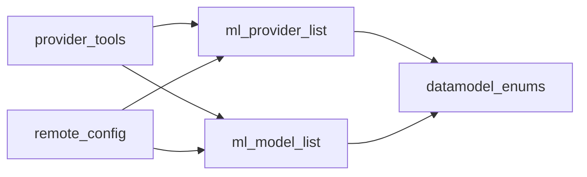

# Architecture: Model Agent Info

This project is small, so the whole design fits in this file. No component
docs.

Read with [functional_spec.md](functional_spec.md), which gives the
contracts and rules this design implements.

## Files

| File | Change |
|---|---|
| `libs/core/kiln_ai/adapters/model_agent_info.py` | New. Tag maps (meaning, kind, set limit), tag format, limits, note labels. |
| `libs/core/kiln_ai/adapters/ml_provider_list.py` | New. `KilnProviderInfo`, `built_in_providers`, `get_provider_info`. |
| `libs/core/kiln_ai/adapters/ml_model_list.py` | New fields on `KilnModel` and `KilnModelProvider`. |
| `libs/core/kiln_ai/adapters/provider_tools.py` | `provider_name_from_id` reads the provider list. |
| `libs/core/kiln_ai/adapters/remote_config.py` | `serialize_config` writes `provider_list`. |
| `libs/core/kiln_ai/adapters/test_model_agent_info.py` | New. Tests of the vocabulary module. |
| `libs/core/kiln_ai/adapters/test_ml_provider_list.py` | New. Data tests of the provider list. |
| `libs/core/kiln_ai/adapters/test_ml_model_list.py` | Data tests of model notes and tags. |
| `libs/core/kiln_ai/adapters/test_remote_config.py` | Serialize and load tests; new `serialize_config` argument. |
| `libs/core/kiln_ai/adapters/test_provider_tools.py` | Coverage of `provider_name_from_id` for every provider. |
| `.agents/skills/claude-maintain-models/SKILL.md` | Notes and tags workflow; provider list in the provider checklist. |
| `.agents/skills/kiln-model-sweep/SKILL.md` | `ml_provider_list.py` in the publish-check file list. |
| `.agents/skills/kiln-conventions/references/core.md` | Provider list in "Where things go" and the provider touchpoints. |

Import direction, all inside `kiln_ai.adapters`:



`model_agent_info` imports nothing from Kiln. Only tests import it. No new
import cycle.

## `model_agent_info.py`

The vocabulary for agent-facing notes and tags. Module docstring: the tags
and notes in the model list and provider list are for agents that choose or
configure a model; these rules are enforced by tests on the built-in data,
never at parse time, so an older client keeps loading a newer file.

Revised for the 2026-11-15 vocabulary. The first version (tag to meaning
string, `best_value`, `strong_*`, `verbose`, `fast`, `very_fast`) is
replaced.

```python
TAG_PATTERN: Final = re.compile(r"^[a-z0-9_]{1,40}$")
MAX_TAGS_PER_ENTRY: Final = 12
MAX_NOTE_CHARS: Final = 2000


class TagKind(str, Enum):
    lineage = "lineage"
    set = "set"


@dataclass(frozen=True)
class TagInfo:
    meaning: str
    kind: TagKind
    max_models: int | None  # set tags only; None for lineage


MODEL_TAGS: Final[Mapping[str, TagInfo]] = {
    "current": TagInfo("...", TagKind.lineage, None),
    "recommended": TagInfo("...", TagKind.set, 20),
    "top_value": TagInfo("...", TagKind.set, 14),
    "top_fast": TagInfo("...", TagKind.set, 14),
    "top_on_device": TagInfo("...", TagKind.set, 14),
    "top_open": TagInfo("...", TagKind.set, 14),
    "top_writing": TagInfo("...", TagKind.set, 14),
}
PROVIDER_ENTRY_TAGS: Final[Mapping[str, TagInfo]] = {}
PROVIDER_LIST_TAGS: Final[Mapping[str, TagInfo]] = {}

# Labels of a model note, in the required order.
MODEL_NOTE_LABELS: Final = (
    "Description:", "Lineup:", "Superseded by:", "Same weights:", "Useful for:",
    "Strengths:", "Behavior:", "Deployment:",
)
# Labels of a provider note, in the required order.
PROVIDER_NOTE_LABELS: Final = (
    "Data retention:", "Rate limits:", "Routing:", "Gotchas:",
)
```

- The meanings are the functional spec's model-tag table, word for word.
- The module docstring says: every tag except `current` is a set tag; the
  `current` procedure and the set-review procedure are in
  `claude-maintain-models`; the rules are enforced by tests on the built-in
  data, never at parse time.
- A one-line comment above each map says where its tags go (model,
  provider entry, provider-list item). The two empty maps say they are
  kept for later use.
- Plain dict literals typed as `Mapping`, so the type checker rejects a
  write. Nothing mutates them (conventions rule C7). `TagInfo` is frozen.
- `TagInfo` is a frozen dataclass, not a Pydantic model: it is never
  parsed or serialized.
- No functions. The checks are test code (conventions rule E20).
- In `ml_model_list.py` and `ml_provider_list.py`, a note is written as
  adjacent string literals, one per labeled line, each but the last ending
  in `\n`, so each line is one source line.

## `ml_provider_list.py`

Module docstring: facts about each model provider, published in the remote
config as `provider_list` for agents outside Kiln; Kiln clients do not load
it from the remote config; it is also the source of the friendly provider
names.

```python
class KilnProviderInfo(BaseModel):
    """..."""  # Attributes section, one line per field, per the functional spec

    id: ModelProviderName
    friendly_name: str
    notes: str | None = None
    tags: list[str] = Field(default_factory=list)
    models_dev_id: str | None = None


built_in_providers: tuple[KilnProviderInfo, ...] = (
    KilnProviderInfo(
        id=ModelProviderName.openai,
        friendly_name="OpenAI",
        models_dev_id="openai",
    ),
    ...
)


def get_provider_info(provider: ModelProviderName) -> KilnProviderInfo:
    """The built-in info for a provider. Raises ValueError if the list has no item for it."""
```

- A tuple, not a list: the list is fixed at release and nothing refreshes
  it. This also keeps it clear of the runtime swap that the model lists get.
- One item per `ModelProviderName`, in enum declaration order. The friendly
  names are copied from the current `match` in `provider_name_from_id`. The
  `models_dev_id` values are the overview's table; the rest are `None`.
- The `notes` docstring line says what a note holds and points to
  `model_agent_info` for the rules. The `models_dev_id` line says `None`
  means models.dev has no entry for the provider, or the mapping is not
  checked.
- `get_provider_info` is a linear scan; the list has about 20 items and the
  callers are not hot. Raising on a missing item cannot happen with the
  tests below, so the error is a guard, not a path.

## `ml_model_list.py`

`KilnModel`, under the existing `# Editorial` fields:

```python
    agent_notes: str | None = None
    tags: list[str] = Field(default_factory=list)
```

`KilnModelProvider`, after `deprecated`:

```python
    tags: list[str] = Field(default_factory=list)
```

- Docstring lines in each class's Attributes section, as the functional
  spec's contracts say. The `agent_notes` line contrasts it with
  `editorial_notes`.
- No validators. Add `Field` to the `pydantic` import.
- No data changes in this file until the backfill.

## `provider_tools.py`

```python
def provider_name_from_id(id: str) -> str:
    if id in ModelProviderName.__members__:
        return get_provider_info(ModelProviderName(id)).friendly_name
    return "Unknown provider: " + id
```

- The docstring keeps its Args and Returns, and its Raises line says the
  `ValueError` comes from a provider missing from the provider list.
- The 50-line `match` goes. `raise_exhaustive_enum_error` stays imported;
  another function in the file uses it.

## `remote_config.py`

```python
def serialize_config(
    models: List[KilnModel],
    embedding_models: List[KilnEmbeddingModel],
    reranker_models: List[KilnRerankerModel],
    providers: Sequence[KilnProviderInfo],
    path: str | Path,
) -> None:
    data = {
        ...existing three keys...,
        "provider_list": [p.model_dump(mode="json") for p in providers],
    }
```

- `providers` is a required argument before `path`, so a caller cannot
  forget it. `dump_builtin_config` passes `built_in_providers`. The two test
  callers pass it too.
- A short comment at the `provider_list` key says it is published for
  agents outside Kiln and that `deserialize_config_data` does not load it.
- `deserialize_config_data` and `KilnRemoteConfig` do not change.
- `model_dump(mode="json")` already writes the new model fields, so the
  `model_list` code does not change.

## Error handling

There is no new runtime error path. Bad data is a test failure before
merge. At parse time, unknown tags and long notes load as they are, and an
unknown top-level key is ignored, as today. The one raise
(`get_provider_info`) is unreachable while the coverage test passes.

## Tests

All pytest, in `libs/core/kiln_ai/adapters/`. Read `python_test_guide.md`
(via `get_prompt`) before writing them. Use `pytest.mark.parametrize` over
the built-in data so a failure names the model or provider.

`test_model_agent_info.py`:

- Each key of the three maps matches `TAG_PATTERN`; each meaning is a
  non-blank string.
- No tag is in more than one map.
- The model map has exactly one lineage tag, `current`, with
  `max_models is None`. Every set tag has `max_models` of at least 1.
- The starting tags are exactly the functional spec's: the model map has
  `current`, `recommended`, `top_value`, `top_fast`, `top_on_device`,
  `top_open`, `top_writing`, with those kinds and limits; the provider-entry
  and provider-list maps are empty. A later change that adds a tag updates
  this test too, which is the intended review point.
- `MODEL_NOTE_LABELS` and `PROVIDER_NOTE_LABELS` have no duplicates, and
  each label ends with `:`.

`test_ml_model_list.py`, over `built_in_models`:

- Model tags: each matches `TAG_PATTERN`, is in `MODEL_TAGS`, no
  duplicates, at most `MAX_TAGS_PER_ENTRY`.
- Provider-entry tags: the same against `PROVIDER_ENTRY_TAGS` (so, today,
  none).
- `agent_notes`: `None`, or `strip()` is non-empty and `len` is at most
  `MAX_NOTE_CHARS`.
- Note format, by a helper `assert_note_format(note, labels, required)`
  in `test_model_agent_info.py`: split on `\n`; each line starts with a
  label from `labels`; labels appear in that order, each at most once;
  each label in `required` is present. For model notes, `labels` is
  `MODEL_NOTE_LABELS`, `required` is `Description:` and `Lineup:`, and the
  first line is `Description:`.
- A `current` model has no `Superseded by:`. A model with a note that is
  not `current` has `Superseded by:` or `Same weights:` (revision 2).
- Each set tag is on at most `max_models` models (one test parametrized
  over the set tags, counting across `built_in_models`).
- Each model with `recommended` also has `current`.
- Each model with any tag has `agent_notes`.
- The tag check is one helper function, `assert_valid_tags(tags, allowed)`,
  defined in `test_model_agent_info.py` and imported from there by
  `test_ml_model_list.py` and `test_ml_provider_list.py`. It checks format,
  membership, duplicates and count, and names the bad tag in its message.
  `allowed` is a tag map; only its keys are used.

`test_ml_provider_list.py`:

- `[p.id for p in built_in_providers] == list(ModelProviderName)`: one item
  per provider, in enum order, no duplicates.
- Each `friendly_name` is non-blank.
- Each `models_dev_id` is `None` or matches `^[a-z0-9-]+$`.
- Tags against `PROVIDER_LIST_TAGS`; notes by the note rule, and by
  `assert_note_format` with `PROVIDER_NOTE_LABELS` and no required label
  (at least one line).
- `get_provider_info` returns the item for each provider.

`test_provider_tools.py`:

- The existing tests stay. Add one parametrized over every
  `ModelProviderName`: `provider_name_from_id(p.value)` is non-blank and
  does not start with `"Unknown provider"`. The existing parametrized test
  keeps the exact names.

`test_remote_config.py`:

- Update the two `serialize_config` calls.
- Serialized file: `provider_list` has `len(ModelProviderName)` items, each
  with exactly the keys `{"id", "friendly_name", "notes", "tags",
  "models_dev_id"}`, and `id` values equal the enum values. Each model has
  `agent_notes` and `tags`; each provider entry has `tags`.
- `deserialize_config_data` with a dict that has `provider_list` (including
  a malformed one, such as a string) loads the models.
- A model with `tags: ["not_a_known_tag"]` and `agent_notes` of 3,000
  characters, and a provider entry with an unknown tag, load unchanged.
- A payload without the new fields loads with the defaults.
- The existing round-trip test covers the new model fields.

Checks to run: the project's full checks (`uv run ./checks.sh --agent-mode`,
or its parts where it cannot finish), the conventions gate on the diff, and
`KILN_TEST_COMPATIBILITY=1 uv run python3 -m pytest
libs/core/kiln_ai/adapters/test_remote_config.py::test_backwards_compatibility_with_v0_19 -s -v`.
The OpenAPI schema check must still pass; no API returns these models
directly, so the schema should not change. If it does change, that is a
finding to report, not to regenerate silently.

## Skill changes

`claude-maintain-models`:

- The section "Agent notes and tags" (added in Phase 2) is rewritten for
  the 2026-11-15 vocabulary. It holds, in this order:
  1. What the notes and tags are for: an agent choosing or configuring a
     model; `recommended` is its main candidate list, and a model without
     `current` is not chosen for a new run config unless asked.
  2. The note format table, the "never in a note" list and the rule
     against words relative to time, from the functional spec.
  3. The approved examples, word for word, with their tags.
  4. The provider note format.
  5. Tags: the two kinds; "every tag except `current` is a set tag"; read
     each tag's meaning, kind and limit in
     `libs/core/kiln_ai/adapters/model_agent_info.py`.
  6. The `current` procedure (price level, snapshots, variants, serving
     variants and the `Same weights:` line, the `Superseded by:` line), as
     numbered steps.
  7. The set-review procedure, as numbered steps, with the limits, the
     `recommended`-is-`current` rule and the `recommended` bar.
  8. Sources: Artificial Analysis first for comparisons across labs (model
     pages give the intelligence index, cost per task, output speed, time
     to first token and output tokens used); a lab's release benchmarks
     are chosen to look good and are support only; common sense.
  9. How to add a tag (map, meaning, kind, limit, `test_model_agent_info.py`,
     same change), and that an unsupported claim is left out, with the PR
     saying so.
- Phase 3: the subsection "Agent notes and tags" after 3b, for each new
  model: write the note and tags, run the `current` procedure, run the
  set-review procedure for each set the model could join. Provider entries
  get no tags.
- The PR description step: when any set changed, a section at the top
  lists each addition and removal, per set, with a short reason.
- "Adding a Net-New Provider": in the libs/core touchpoints, replace the
  `provider_name_from_id` part of the `provider_tools.py` item with a new
  item for `built_in_providers` in `ml_provider_list.py`. "Friendly names
  everywhere": the Python name map is the provider list, and a test (not the
  type checker) catches a missing item.

`kiln-model-sweep`: add `ml_provider_list.py` to the files its publish check
diffs (done in Phase 2). Its PR description puts set changes at the top.

`kiln-conventions/references/core.md`: "Where things go" names
`ml_provider_list.py` for a provider's info; "Adding a provider" item 3
names the provider list instead of `provider_name_from_id`.

Run the `docs-sync` skill for anything else that names
`provider_name_from_id`'s match or the published file's keys.

## Backfill design

The backfill is data entry with research. It changes `ml_model_list.py`
(agent notes, model tags), `ml_provider_list.py` (provider notes, the
`huggingface` `models_dev_id`) and adds
`specs/projects/model-agent-info/backfill_sources.md`. It writes no
provider-entry or provider-list tags.

1. Fetch `https://models.dev/api.json` once into a scratch directory.
2. Build the selection with a throwaway script (not committed): for each
   model, its featured rank, and for each provider entry that is not
   deprecated, the models.dev `release_date` under
   (`models_dev_id`, `model_id`). Select by the functional spec's rule,
   with "today" as the run date. For local-only models (only Ollama or
   Docker Model Runner entries), take the release date from the lab's
   model card. Record the selected list, with dates and the date source,
   at the top of the sources log.
3. Collect Artificial Analysis data for the selected models from their
   model pages (`https://artificialanalysis.ai/models/<slug>`): the
   intelligence index, cost per task, output speed, time to first token,
   and output tokens used. Keep it in a scratch table; the figures used
   for a tag or a claim go into the sources log. A model with no AA page
   is judged on the other sources.
4. Lab by lab: write the notes for each lab's selected models as one
   batch, so the `Lineup:` lines agree, and assign `current` by the
   functional spec's rules. Sub-agents may take one lab each; each returns
   its edits and its sources.
5. Sets: build each set as one review across all selected models, using
   the scratch table, within its limit. `recommended` is built last, from
   the `current` models, by the functional spec's `recommended` bar: plot
   AA intelligence index against cost per task and keep the models near
   the top for their cost, across all labs.
6. Provider notes from each provider's own documentation, in the provider
   note format.
7. Run the data tests after each batch.
8. The sources log follows the functional spec's sources-log rule: per
   set, one row per member with AA figures, the AA URL and a comparative
   reason; per model and per provider, the source URL behind each line.

The PR from this phase lists, at the top, the members of each set. Then
the counts (models selected, models with notes, models `current`) and any
selected model left empty, with the reason.
