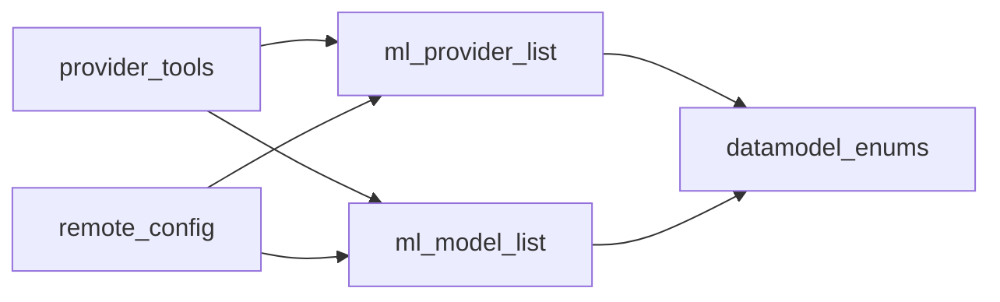

# Architecture: Model Agent Info

This project is small, so the whole design fits in this file. No component
docs.

Read with [functional_spec.md](functional_spec.md), which gives the
contracts and rules this design implements.

## Files

| File | Change |
|---|---|
| `libs/core/kiln_ai/adapters/model_agent_info.py` | New. Tag maps, tag format, limits. |
| `libs/core/kiln_ai/adapters/ml_provider_list.py` | New. `KilnProviderInfo`, `built_in_providers`, `get_provider_info`. |
| `libs/core/kiln_ai/adapters/ml_model_list.py` | New fields on `KilnModel` and `KilnModelProvider`. |
| `libs/core/kiln_ai/adapters/provider_tools.py` | `provider_name_from_id` reads the provider list. |
| `libs/core/kiln_ai/adapters/remote_config.py` | `serialize_config` writes `provider_list`. |
| `libs/core/kiln_ai/adapters/test_model_agent_info.py` | New. Tests of the vocabulary module. |
| `libs/core/kiln_ai/adapters/test_ml_provider_list.py` | New. Data tests of the provider list. |
| `libs/core/kiln_ai/adapters/test_ml_model_list.py` | Data tests of model notes and tags. |
| `libs/core/kiln_ai/adapters/test_remote_config.py` | Serialize and load tests; new `serialize_config` argument. |
| `libs/core/kiln_ai/adapters/test_provider_tools.py` | Coverage of `provider_name_from_id` for every provider. |
| `.agents/skills/claude-maintain-models/SKILL.md` | Notes and tags workflow; provider list in the provider checklist. |
| `.agents/skills/kiln-model-sweep/SKILL.md` | `ml_provider_list.py` in the publish-check file list. |
| `.agents/skills/kiln-conventions/references/core.md` | Provider list in "Where things go" and the provider touchpoints. |

Import direction, all inside `kiln_ai.adapters`:



`model_agent_info` imports nothing from Kiln. Only tests import it. No new
import cycle.

## `model_agent_info.py`

The vocabulary for agent-facing notes and tags. Module docstring: the tags
and notes in the model list and provider list are for agents that choose or
configure a model; these rules are enforced by tests on the built-in data,
never at parse time, so an older client keeps loading a newer file.

```python
TAG_PATTERN: Final = re.compile(r"^[a-z0-9_]{1,40}$")
MAX_TAGS_PER_ENTRY: Final = 12
MAX_NOTE_CHARS: Final = 2000

MODEL_TAGS: Final[Mapping[str, str]] = {
    "best_value": "Its quality for its price is among the best at that price.",
    "strong_agentic": "...",
    "strong_coding": "...",
    "strong_writing": "...",
    "verbose": "...",
}
PROVIDER_ENTRY_TAGS: Final[Mapping[str, str]] = {
    "very_fast": "...",
    "fast": "...",
}
PROVIDER_LIST_TAGS: Final[Mapping[str, str]] = {}
```

- The meanings are the overview's tag table, word for word.
- A one-line comment above each map says where its tags go (model,
  provider entry, provider-list item).
- Plain dict literals typed as `Mapping`, so the type checker rejects a
  write. Nothing mutates them (conventions rule C7).
- No functions. The checks are test code (conventions rule E20).

## `ml_provider_list.py`

Module docstring: facts about each model provider, published in the remote
config as `provider_list` for agents outside Kiln; Kiln clients do not load
it from the remote config; it is also the source of the friendly provider
names.

```python
class KilnProviderInfo(BaseModel):
    """..."""  # Attributes section, one line per field, per the functional spec

    id: ModelProviderName
    friendly_name: str
    notes: str | None = None
    tags: list[str] = Field(default_factory=list)
    models_dev_id: str | None = None


built_in_providers: tuple[KilnProviderInfo, ...] = (
    KilnProviderInfo(
        id=ModelProviderName.openai,
        friendly_name="OpenAI",
        models_dev_id="openai",
    ),
    ...
)


def get_provider_info(provider: ModelProviderName) -> KilnProviderInfo:
    """The built-in info for a provider. Raises ValueError if the list has no item for it."""
```

- A tuple, not a list: the list is fixed at release and nothing refreshes
  it. This also keeps it clear of the runtime swap that the model lists get.
- One item per `ModelProviderName`, in enum declaration order. The friendly
  names are copied from the current `match` in `provider_name_from_id`. The
  `models_dev_id` values are the overview's table; the rest are `None`.
- The `notes` docstring line says what a note holds and points to
  `model_agent_info` for the rules. The `models_dev_id` line says `None`
  means models.dev has no entry for the provider, or the mapping is not
  checked.
- `get_provider_info` is a linear scan; the list has about 20 items and the
  callers are not hot. Raising on a missing item cannot happen with the
  tests below, so the error is a guard, not a path.

## `ml_model_list.py`

`KilnModel`, under the existing `# Editorial` fields:

```python
    agent_notes: str | None = None
    tags: list[str] = Field(default_factory=list)
```

`KilnModelProvider`, after `deprecated`:

```python
    tags: list[str] = Field(default_factory=list)
```

- Docstring lines in each class's Attributes section, as the functional
  spec's contracts say. The `agent_notes` line contrasts it with
  `editorial_notes`.
- No validators. Add `Field` to the `pydantic` import.
- No data changes in this file until the backfill.

## `provider_tools.py`

```python
def provider_name_from_id(id: str) -> str:
    if id in ModelProviderName.__members__:
        return get_provider_info(ModelProviderName(id)).friendly_name
    return "Unknown provider: " + id
```

- The docstring keeps its Args and Returns, and its Raises line says the
  `ValueError` comes from a provider missing from the provider list.
- The 50-line `match` goes. `raise_exhaustive_enum_error` stays imported;
  another function in the file uses it.

## `remote_config.py`

```python
def serialize_config(
    models: List[KilnModel],
    embedding_models: List[KilnEmbeddingModel],
    reranker_models: List[KilnRerankerModel],
    providers: Sequence[KilnProviderInfo],
    path: str | Path,
) -> None:
    data = {
        ...existing three keys...,
        "provider_list": [p.model_dump(mode="json") for p in providers],
    }
```

- `providers` is a required argument before `path`, so a caller cannot
  forget it. `dump_builtin_config` passes `built_in_providers`. The two test
  callers pass it too.
- A short comment at the `provider_list` key says it is published for
  agents outside Kiln and that `deserialize_config_data` does not load it.
- `deserialize_config_data` and `KilnRemoteConfig` do not change.
- `model_dump(mode="json")` already writes the new model fields, so the
  `model_list` code does not change.

## Error handling

There is no new runtime error path. Bad data is a test failure before
merge. At parse time, unknown tags and long notes load as they are, and an
unknown top-level key is ignored, as today. The one raise
(`get_provider_info`) is unreachable while the coverage test passes.

## Tests

All pytest, in `libs/core/kiln_ai/adapters/`. Read `python_test_guide.md`
(via `get_prompt`) before writing them. Use `pytest.mark.parametrize` over
the built-in data so a failure names the model or provider.

`test_model_agent_info.py`:

- Each key of the three maps matches `TAG_PATTERN`; each meaning is a
  non-blank string.
- No tag is in both the model map and the provider-entry map.
- The starting tags are exactly the overview's: the model map has
  `best_value`, `strong_agentic`, `strong_coding`, `strong_writing`,
  `verbose`; the provider-entry map has `fast`, `very_fast`; the
  provider-list map is empty. A later change that adds a tag updates this
  test too, which is the intended review point.

`test_ml_model_list.py`, over `built_in_models`:

- Model tags: each matches `TAG_PATTERN`, is in `MODEL_TAGS`, no
  duplicates, at most `MAX_TAGS_PER_ENTRY`.
- Provider-entry tags: the same against `PROVIDER_ENTRY_TAGS`.
- `agent_notes`: `None`, or `strip()` is non-empty and `len` is at most
  `MAX_NOTE_CHARS`.
- The tag check is one helper function, `assert_valid_tags(tags, allowed)`,
  defined in `test_model_agent_info.py` and imported from there by
  `test_ml_model_list.py` and `test_ml_provider_list.py`. It checks format,
  membership, duplicates and count, and names the bad tag in its message.

`test_ml_provider_list.py`:

- `[p.id for p in built_in_providers] == list(ModelProviderName)`: one item
  per provider, in enum order, no duplicates.
- Each `friendly_name` is non-blank.
- Each `models_dev_id` is `None` or matches `^[a-z0-9-]+$`.
- Tags against `PROVIDER_LIST_TAGS`; notes by the note rule.
- `get_provider_info` returns the item for each provider.

`test_provider_tools.py`:

- The existing tests stay. Add one parametrized over every
  `ModelProviderName`: `provider_name_from_id(p.value)` is non-blank and
  does not start with `"Unknown provider"`. The existing parametrized test
  keeps the exact names.

`test_remote_config.py`:

- Update the two `serialize_config` calls.
- Serialized file: `provider_list` has `len(ModelProviderName)` items, each
  with exactly the keys `{"id", "friendly_name", "notes", "tags",
  "models_dev_id"}`, and `id` values equal the enum values. Each model has
  `agent_notes` and `tags`; each provider entry has `tags`.
- `deserialize_config_data` with a dict that has `provider_list` (including
  a malformed one, such as a string) loads the models.
- A model with `tags: ["not_a_known_tag"]` and `agent_notes` of 3,000
  characters, and a provider entry with an unknown tag, load unchanged.
- A payload without the new fields loads with the defaults.
- The existing round-trip test covers the new model fields.

Checks to run: the project's full checks (`uv run ./checks.sh --agent-mode`,
or its parts where it cannot finish), the conventions gate on the diff, and
`KILN_TEST_COMPATIBILITY=1 uv run python3 -m pytest
libs/core/kiln_ai/adapters/test_remote_config.py::test_backwards_compatibility_with_v0_19 -s -v`.
The OpenAPI schema check must still pass; no API returns these models
directly, so the schema should not change. If it does change, that is a
finding to report, not to regenerate silently.

## Skill changes

`claude-maintain-models`:

- A new section, "Agent notes and tags", placed after "Phase 3" subsections
  and linked from them. It holds: what goes in `agent_notes` and what does
  not (the overview's lists); the note rules; the tag rules; that the tag
  list and meanings live in `libs/core/kiln_ai/adapters/model_agent_info.py`
  and the agent reads it there; how to add a tag (add to the right map with
  its meaning, update `test_model_agent_info.py`, in the same change); and
  that an unsupported claim is left out, with the PR saying so.
- Phase 3: a new subsection after 3b, "Agent notes and tags", one short
  paragraph pointing to the section above, for each new model and each new
  provider entry.
- "Adding a Net-New Provider": in the libs/core touchpoints, replace the
  `provider_name_from_id` part of the `provider_tools.py` item with a new
  item for `built_in_providers` in `ml_provider_list.py`. "Friendly names
  everywhere": the Python name map is the provider list, and a test (not the
  type checker) catches a missing item.

`kiln-model-sweep`: add `ml_provider_list.py` to the files its publish check
diffs.

`kiln-conventions/references/core.md`: "Where things go" names
`ml_provider_list.py` for a provider's info; "Adding a provider" item 3
names the provider list instead of `provider_name_from_id`.

Run the `docs-sync` skill for anything else that names
`provider_name_from_id`'s match or the published file's keys.

## Backfill design

The backfill is data entry with research. It changes `ml_model_list.py`
(agent notes, model tags, provider-entry tags), `ml_provider_list.py`
(provider notes, the `huggingface` `models_dev_id`) and adds
`specs/projects/model-agent-info/backfill_sources.md`.

1. Fetch `https://models.dev/api.json` once into a scratch directory.
2. Build the selection with a throwaway script (not committed): for each
   model, its featured rank, and for each provider entry that is not
   deprecated, the models.dev `release_date` under
   (`models_dev_id`, `model_id`). Select by the functional spec's rule,
   with "today" as the run date. Record the selected list, with dates, at
   the top of the sources log.
3. Group the selected models by family. Research and write each family as
   one batch, so notes compare models with their real peers. Sub-agents may
   take one family each; each returns its edits and its sources.
4. Provider notes from each provider's own documentation: data retention,
   rate limits, routing and gotchas.
5. Run the data tests after each batch.
6. The sources log has one section per model and per provider: the note,
   each tag, and the source URL or Kiln test behind each claim.

The PR from this phase lists the counts (models selected, models with
notes, tags used) and any selected model left empty, with the reason.
