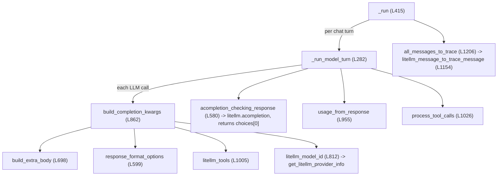

# LiteLlmAdapter: request building, tool loop, response reading

Scope: the non-streaming path through `LiteLlmAdapter` (`libs/core/kiln_ai/adapters/model_adapters/litellm_adapter.py`) and the helpers it calls. Line numbers are from commit `579014ab` (branch `claude/pensive-cannon-3jnl5q`, on top of `main` at `40ddbd84`), read 2026-10-30. LiteLLM is pinned `litellm>=1.102.0,<1.103` ([libs/core/pyproject.toml:49](../../../../libs/core/pyproject.toml#L49)); installed version 1.102.0.

Labels used below: **Read** = stated by the code. **Observed** = I ran it offline (no network; `respx` intercepted every HTTP call). **Inference** = my reading, not verified.

## 1. Call graph



Every model call in the agent path goes through one function: `litellm.acompletion` in `acompletion_checking_response` ([L580-594](../../../../libs/core/kiln_ai/adapters/model_adapters/litellm_adapter.py#L580)), or `litellm.acompletion(stream=True)` in `StreamingCompletion` for streaming (see [streaming-and-ai-sdk.md](./streaming-and-ai-sdk.md)). There is no other model-call site in the adapter.

## 2. Request building

### `build_completion_kwargs` ([L862-953](../../../../libs/core/kiln_ai/adapters/model_adapters/litellm_adapter.py#L862))

Read. Builds one dict passed straight to `litellm.acompletion(**kwargs)`:

| Key | Source | Notes for a Responses migration |
|---|---|---|
| `model` | `litellm_model_id()` → `get_litellm_provider_info(provider).litellm_model_id`, i.e. `"openai/<model_id>"` for provider `openai` | The routing point if LiteLLM's `openai/responses/<model>` prefix is used. Cached in `self._litellm_model_id` ([L812-825](../../../../libs/core/kiln_ai/adapters/model_adapters/litellm_adapter.py#L812)). |
| `messages` | caller list, deep-copied, then `sanitize_messages_for_provider` (strips `KILN_ONLY_MESSAGE_FIELDS`) and `replace_unparseable_tool_arguments`; Cerebras also strips reasoning fields ([L946-951](../../../../libs/core/kiln_ai/adapters/model_adapters/litellm_adapter.py#L946)) | Mixed list: dicts (system/user/tool and prior-trace messages) plus LiteLLM `Message` objects from earlier calls in the same run. |
| `api_base`, `headers` | `LiteLlmConfig.base_url`, `default_headers` | `None` for OpenAI direct. Azure sets `api_base` to the user's endpoint. |
| `temperature`, `top_p` | run config, always sent (default 1.0) | `drop_params=True` lets LiteLLM drop them. Observed: for `gpt-5.4-pro` routed to `/v1/responses`, `temperature: 1.0` was still sent and `top_p` was dropped. |
| `drop_params` | `True` always | |
| `**extra_body` | `build_extra_body(provider)` | See below. |
| `**additional_body_options` | `LiteLlmConfig.additional_body_options` | For OpenAI: `{"api_key": ...}` ([provider_tools.py:717-722](../../../../libs/core/kiln_ai/adapters/provider_tools.py#L717)). For Azure: `api_key` and `"api_version": "2025-02-01-preview"` ([provider_tools.py:796-802](../../../../libs/core/kiln_ai/adapters/provider_tools.py#L796)). |
| `cache_control_injection_points` | only when `AdapterConfig.automatic_prompt_caching` ([L889-895](../../../../libs/core/kiln_ai/adapters/model_adapters/litellm_adapter.py#L889)) | Used by synthetic-user runs ([runner.py:602](../../../../libs/core/kiln_ai/synthetic_user/runner.py#L602), [eval_drive.py:61](../../../../libs/core/kiln_ai/synthetic_user/eval_drive.py#L61)). |
| `tools`, `tool_choice: "auto"` | `litellm_tools()` when the run config has tools ([L897-901](../../../../libs/core/kiln_ai/adapters/model_adapters/litellm_adapter.py#L897)) | **Not gated by `provider.supports_function_calling`.** The flag is never read at run time (grep of `libs/` and `app/` finds it only in the model list, API responses, and UI). |
| `response_format` or `tools`/`tool_choice` for `task_response` | `response_format_options()` unless `skip_response_format` | Raises if both user tools and function-calling structured output are requested ([L924-927](../../../../libs/core/kiln_ai/adapters/model_adapters/litellm_adapter.py#L924)). |
| `logprobs`, `top_logprobs` | only when `top_logprobs` is set (G-Eval judges) | No affected OpenAI provider has `supports_logprobs=True`; only GPT-4.1/4o do. |
| `allowed_openai_params` | auto-adds `tools`/`tool_choice` when present, plus `provider.litellm_allowed_openai_params` ([L827-860](../../../../libs/core/kiln_ai/adapters/model_adapters/litellm_adapter.py#L827), [L935-944](../../../../libs/core/kiln_ai/adapters/model_adapters/litellm_adapter.py#L935)) | |

Observed request kwargs today for `gpt_5_4` / `openai` at thinking level `medium`, no tools, no structured output: `{'model': 'openai/gpt-5.4', 'api_base': None, 'headers': None, 'temperature': 1.0, 'top_p': 1.0, 'drop_params': True, 'reasoning_effort': 'medium'}` (plus `messages`, `api_key`).

### `build_extra_body` ([L698-810](../../../../libs/core/kiln_ai/adapters/model_adapters/litellm_adapter.py#L698))

Read. Provider-specific extras, almost all for non-OpenAI providers. The only branch an OpenAI-direct provider hits is the generic thinking branch:

- thinking level = run config's `thinking_level` if explicitly set, else `provider.default_thinking_level` ([L706-710](../../../../libs/core/kiln_ai/adapters/model_adapters/litellm_adapter.py#L706)).
- If the provider has `available_thinking_levels`, `extra_body["reasoning_effort"] = thinking_level` as a plain string ([L733](../../../../libs/core/kiln_ai/adapters/model_adapters/litellm_adapter.py#L733)). `"none"` is sent as the string `"none"` for OpenAI.
- Nothing asks for a reasoning summary (`reasoning_summary`), `store`, or `include`. There is no OpenAI-specific branch at all.

Consequence (Inference, consistent with the trace and intermediate-output code below): on Chat Completions OpenAI returns no reasoning text, so `intermediate_outputs["reasoning"]` is never set for OpenAI-direct runs, and every OpenAI-direct provider has `reasoning_capable=False`. A migration that requests summaries would start filling `intermediate_outputs["reasoning"]` and the trace's `reasoning_content` for these models: a visible behavior change in the UI and in eval inputs.

### `response_format_options` / `json_schema_response_format` / `tool_call_params` ([L599-696](../../../../libs/core/kiln_ai/adapters/model_adapters/litellm_adapter.py#L599))

Read.

- All ten affected OpenAI-direct providers use `structured_output_mode=json_schema` → `{"response_format": {"type": "json_schema", "json_schema": {"name": "task_response", "schema": ...}}}`. **No `strict` key is set** ([L658-665](../../../../libs/core/kiln_ai/adapters/model_adapters/litellm_adapter.py#L658)). The schema is closed with `close_object_schemas(..., strict=True)` and stripped of numeric bounds.
- `function_calling` mode sends a forced `tool_choice` for the `task_response` tool with `strict: True`; `function_calling_weak` omits `strict`; `default` uses function calling, strict only when the provider is `openai` ([L625-637](../../../../libs/core/kiln_ai/adapters/model_adapters/litellm_adapter.py#L625)).
- The UI offers every structured-output mode for every model ([advanced_run_options.svelte:67-118](../../../../app/web_ui/src/lib/ui/run_config_component/advanced_run_options.svelte#L67)); nothing filters on `supports_function_calling`. **Inference:** a user who picks `function_calling` (or `function_calling_weak`) structured output on e.g. GPT-5.4 direct with a thinking level other than `none` sends `tools` + `reasoning_effort` to `/v1/chat/completions` anyway, so the current workaround (`supports_function_calling=False`) does not cover that path. Whether OpenAI rejects that exact request is for the history/OpenAI subtopics to confirm.

### `litellm_tools` and `strict` ([L1005-1024](../../../../libs/core/kiln_ai/adapters/model_adapters/litellm_adapter.py#L1005), [L153-161](../../../../libs/core/kiln_ai/adapters/model_adapters/litellm_adapter.py#L153))

Read. User tools (registry, MCP, Kiln-task tools, skills, unmanaged SDK tools) are sent as Chat Completions function tools with `"strict": false` added unless the tool sets it. The comment says this exists because "OpenAI's Responses API (OpenAI models on OpenRouter, Responses-only models on OpenAI) treats a function tool as strict unless told otherwise". Commit [7b23d5f3](https://github.com/Kiln-AI/Kiln/commit/7b23d5f3) (2026-10-19) message: "OpenAI's Responses API (used for OpenAI models on OpenRouter, and by LiteLLM for Responses-only OpenAI models) treats a function tool as strict unless the request says otherwise." So this part of the request is already Responses-safe. Observed: the bridge forwarded `"strict": false` on the tool.

## 3. The tool loop: `_run_model_turn` ([L282-413](../../../../libs/core/kiln_ai/adapters/model_adapters/litellm_adapter.py#L282))

Read. Per top-level turn, up to `MAX_TOOL_CALLS_PER_TURN = 100` model calls:

1. Build kwargs from a deep copy of `messages`.
2. `acompletion_checking_response` → `(ModelResponse, Choices)`; time it.
3. `usage_from_response` → `MessageUsage`, summed.
4. Read `response_choice.message.content` and `response_function_tool_calls(message.tool_calls)` ([tool_calls.py:35-56](../../../../libs/core/kiln_ai/adapters/litellm_utils/tool_calls.py#L35)); neither → `raise_for_empty_model_response`.
5. **Append the LiteLLM `Message` object itself** to `messages` ([L340](../../../../libs/core/kiln_ai/adapters/model_adapters/litellm_adapter.py#L340)). It stays a `Message` (not a dict) for the rest of the run and is re-sent on the next call.
6. Tool calls: `return_on_tool_call` returns early with `interrupted_by_tool_calls`; otherwise `process_tool_calls` runs them concurrently and appends `role: tool` dicts keyed by `tool_call.id`. A `task_response` call ends the turn with its arguments as the output.
7. No tool calls → content is the turn output.

The `messages` list is mutated in place so a partial trace survives exceptions (contract in `BaseAdapter._run`, [base_adapter.py:553-565](../../../../libs/core/kiln_ai/adapters/model_adapters/base_adapter.py#L553)).

### Observed: reasoning items ride on the `Message` object within a run

Offline probe (script in my scratchpad; `respx` mocks `https://api.openai.com/v1/responses`), model `gpt_5_4_pro` / `openai` (LiteLLM 1.102.0 already sends this model to `/v1/responses` on its own, see §6). First reply: a `reasoning` item (`id: rs_1`, `encrypted_content: "ENC123"`, one summary) and a `function_call` (`call_id: call_abc`). Kiln ran the tool and made a second call whose `input` was:

```
{"type": "message", "role": "user", "content": [{"type": "input_text", "text": "what is 2+2"}]}
{"id": "rs_1", "summary": [...], "type": "reasoning", "encrypted_content": "ENC123"}
{"type": "function_call", "call_id": "call_abc", "name": "add", "arguments": "{\"a\": 2, \"b\": 2}"}
{"type": "function_call_output", "call_id": "call_abc", "output": [{"type": "input_text", "text": "4"}]}
```

The reasoning item survived because the assistant `Message` object kept it in `Message.reasoning_items` (LiteLLM field, `.venv/.../litellm/types/utils.py:1315`), and LiteLLM's bridge reads `msg.get("reasoning_items")` when it rebuilds the input (`.venv/.../litellm/completion_extras/litellm_responses_transformation/transformation.py:110-132`). The system prompt went to `instructions`. The final run succeeded with output `'The answer is [4]'`.

### Observed: a reply with text and a tool call drops the tool call

Same probe, but the first reply had a `message` item ("Let me add those.") before the `function_call`. Result: **one** model call, run output `'Let me add those.'`, the tool never ran, no error. `acompletion_checking_response` returns `response.choices[0]` only ([L594](../../../../libs/core/kiln_ai/adapters/model_adapters/litellm_adapter.py#L594)); a direct check with a hand-built two-choice `ModelResponse` (text in `choices[0]`, tool call in `choices[1]`) confirmed Kiln sees `content='Let me add those.'`, `tool_calls=None`. This is a silent wrong answer, not a crash. Any migration that keeps the bridge must merge or reject multi-choice replies here. (The cause, LiteLLM splitting one reply into several choices, belongs to the LiteLLM subtopic.)

The streaming path differs: see [streaming-and-ai-sdk.md](./streaming-and-ai-sdk.md) §3.

## 4. Reading the response

### `acompletion_checking_response` ([L580-594](../../../../libs/core/kiln_ai/adapters/model_adapters/litellm_adapter.py#L580))

Read. Requires `isinstance(response, ModelResponse)` and `isinstance(response.choices[0], Choices)`, else `RuntimeError("Expected ModelResponse with Choices, ...")`. A native `litellm.aresponses()` call returns a different type, so a native path cannot reuse this function; it would need its own reader that produces the same `(ModelResponse, Choices)` pair or the loop must change type. This method is also the main test seam (see [tests-and-testing-a-routing-flag.md](./tests-and-testing-a-routing-flag.md)).

### `usage_from_response` ([L955-992](../../../../libs/core/kiln_ai/adapters/model_adapters/litellm_adapter.py#L955))

Read. Reads chat-shaped fields only:

- `response._hidden_params["response_cost"]`, falling back to `usage.cost`.
- `usage` must be a LiteLLM `Usage`; reads `prompt_tokens`, `completion_tokens`, `total_tokens`, `prompt_tokens_details.cached_tokens`.
- Reasoning tokens are not read anywhere ([MessageUsage](../../../../libs/core/kiln_ai/utils/usage.py) has no reasoning-token field).

Observed: through the bridge for `gpt-5.4-pro`, a Responses body with `input_tokens: 5, output_tokens: 1, input_tokens_details.cached_tokens: 0` came back as `MessageUsage(input_tokens=5, output_tokens=1, total_tokens=6, cost=0.00033, cached_tokens=0)`. So the bridge maps usage and cost into the shape Kiln reads. A native path would have to do that mapping in Kiln (Responses usage uses `input_tokens`/`output_tokens`/`input_tokens_details`).

### Reasoning and logprobs on the final choice

- `_extract_reasoning_to_intermediate_outputs` ([L565-578](../../../../libs/core/kiln_ai/adapters/model_adapters/litellm_adapter.py#L565)) reads `final_choice.message.reasoning_content` from the **last** call only. Observed: in the tool round trip, the reasoning summary lived on the tool-call message, the final reply had none, so `intermediate_outputs` was `{}` while the trace kept `reasoning_content` on the earlier assistant message.
- `_extract_and_validate_logprobs` ([L545-563](../../../../libs/core/kiln_ai/adapters/model_adapters/litellm_adapter.py#L545)) requires `ChoiceLogprobs` when `top_logprobs` is set. `RunOutput.output_logprobs` is typed `litellm.types.utils.ChoiceLogprobs` ([run_output.py:12-22](../../../../libs/core/kiln_ai/adapters/run_output.py#L12)) and G-Eval reads `.content[].token` ([scoring_utils.py:49-60](../../../../libs/core/kiln_ai/adapters/eval/eval_utils/scoring_utils.py#L49)).
- `BaseAdapter` raises "Reasoning is required for this model" when `provider.reasoning_capable` and no reasoning came back ([base_adapter.py:308-324](../../../../libs/core/kiln_ai/adapters/model_adapters/base_adapter.py#L308)). All OpenAI-direct providers are `reasoning_capable=False`, so this check does not fire for them today.

## 5. Trace conversion

### `litellm_message_to_trace_message` ([L1154-1204](../../../../libs/core/kiln_ai/adapters/model_adapters/litellm_adapter.py#L1154)) and `all_messages_to_trace` ([L1206-1229](../../../../libs/core/kiln_ai/adapters/model_adapters/litellm_adapter.py#L1206))

Read. Converts each LiteLLM `Message` in the run to a `ChatCompletionAssistantMessageParamWrapper` dict keeping only:

- `role` (must be `assistant`), `content`, `reasoning_content`, `tool_calls` (function calls only, as `{id, type: "function", function: {name, arguments}}`), plus Kiln's `latency_ms` and `usage`.

Dropped: `reasoning_items`, `thinking_blocks`, `provider_specific_fields`, `annotations`, `refusal`, `audio`, `images`. Dict messages (system, user, tool, prior-trace) pass through unchanged.

Even if this function kept more, `TaskRun` would drop it: the trace is validated as `list[ChatCompletionMessageParam]` (TypedDicts), and pydantic ignores undeclared keys. Observed:

```python
TypeAdapter(list[ChatCompletionMessageParam]).validate_python([{"role":"assistant","content":"hi",
  "reasoning_content":"r","provider_specific_fields":{...},"kiln_new_field":1}])
# -> [{'role': 'assistant', 'content': 'hi', 'reasoning_content': 'r'}]
```

### Observed: continuation from a saved trace loses the reasoning item

Probe: run 1 as in §3 (tool call, reasoning item `rs_1`), then a second adapter with `prior_trace=run1.trace` and a new user message. The continuation request's `input` held `user`, `function_call`, `function_call_output`, assistant `message`, new `user` — **no reasoning item**. So:

- Within one run (tool loop), reasoning items are replayed, because the `Message` objects stay in memory.
- Across runs (multi-turn chat via `prior_trace`, `return_on_tool_call` resume, synthetic-user turns, `/run` with `parent_task_run_id`), they are lost, because the trace type has no field for them.

To keep them across runs, the trace would need a declared field (for example a `reasoning_items` key on `ChatCompletionAssistantMessageParamWrapper`, kept out of `KILN_ONLY_MESSAGE_FIELDS` so it is sent back). That is additive to the persisted format, but it changes the OpenAPI schema (`app/web_ui/src/lib/api_schema.d.ts:5190` declares this type), and other providers would receive the key on a model switch mid-conversation (Cerebras already needs reasoning fields stripped, [L80-103](../../../../libs/core/kiln_ai/adapters/model_adapters/litellm_adapter.py#L80)). Whether OpenAI needs the items replayed (and with `store` unset, whether ids alone work) is for the OpenAI subtopic.

## 6. What already goes through `/v1/responses` today

Observed with the current code, no changes: `gpt_5_4_pro` / `openai` (and by the same rule `gpt_5_2_pro` / `openai`) is sent by LiteLLM 1.102.0 to `POST https://api.openai.com/v1/responses` with keys `input, instructions, model, reasoning: {"effort": "medium"}, temperature`. `store` was not set. Plain `gpt_5_4` / `openai` went to `/v1/chat/completions` with `reasoning_effort`. LiteLLM's bundled model map lists `gpt-5.4-pro`, `gpt-5.2-pro` and `gpt-5-pro` with `"mode": "responses"` and only `/v1/responses` + `/v1/batch` endpoints; `gpt-5.4` and `gpt-6-astra` are `"mode": "chat"`; `gpt-6.1-sol`, `gpt-6.1-terra`, `gpt-6-sol`, `gpt-6-luna` are absent from the bundled map (`.venv/.../litellm/model_prices_and_context_window_backup.json`, checked with `LITELLM_LOCAL_MODEL_COST_MAP=True`). Kiln does not set `LITELLM_LOCAL_MODEL_COST_MAP`, so at run time LiteLLM may load a newer remote map (LiteLLM subtopic).

So Kiln already runs part of its OpenAI traffic through LiteLLM's chat-to-responses layer, with the public surface (output, usage, cost, trace) working unchanged for the simple case, and with the two defects above (split choices, reasoning items lost across runs) present for those models today.

## 7. `get_litellm_provider_info` ([utils/litellm.py:21-113](../../../../libs/core/kiln_ai/utils/litellm.py#L21))

Read. Maps `ModelProviderName` to a LiteLLM prefix; returns `litellm_model_id = f"{prefix}/{model_id}"`. `openai` → `openai/...`, `azure_openai` → `azure/...`. All "custom" providers (`ollama`, `docker_model_runner`, `siliconflow_cn`, `cloudflare`, `openai_compatible`, `kiln_custom_registry`, `kiln_fine_tune`) also get the `openai/` prefix "only used for format, not url" ([L91-93](../../../../libs/core/kiln_ai/utils/litellm.py#L91)) with an explicit `api_base`.

Used by four callers: the adapter ([L818](../../../../libs/core/kiln_ai/adapters/model_adapters/litellm_adapter.py#L818)), the extractor, the embedding adapter and the reranker adapter. **Inference:** putting routing logic here (rather than in `LiteLlmAdapter.litellm_model_id`) would change the extractor's model id too; and any LiteLLM routing rule keyed on model *name* under the `openai/` prefix can also catch custom OpenAI-compatible endpoints that serve a model with a GPT-looking name. Fine-tuned OpenAI models resolve through `core_provider` to `openai` with model ids like `ft:gpt-4.1-...` ([provider_tools.py:160-201](../../../../libs/core/kiln_ai/adapters/provider_tools.py#L160)); `finetune_provider_model` builds a `KilnModelProvider` with default flags ([L340-376](../../../../libs/core/kiln_ai/adapters/provider_tools.py#L340)), so a new flag defaulting to off would not route them.

## 8. Leads from closed PR #1757, checked against this map

Branch `origin/mike/openai-responses-routing` (6 commits, 2026). Treated as leads only. Its diff touched `ml_model_list.py`, `litellm_adapter.py`, tests, and `utils/test_litellm.py`. What it changed in the adapter (read from `git diff`):

- A provider flag `openai_responses_api`; `litellm_model_id` becomes `openai/responses/<model_id>` when set.
- `acompletion_checking_response` merges split choices into one (`_merge_split_choices`) when the flag is set.
- `json_schema_response_format` adds `"strict": True` when the flag is set ("litellm's responses bridge turns an absent strict into an explicit false").
- `build_extra_body` adds `reasoning_summary="auto"` when the flag is set and effort is not `none`.
- `reasoning_effort` added to `allowed_openai_params`; `temperature`/`top_p` popped when effort is not `none` ("litellm drops both for the gpt-5.x family, but only matches names containing 'gpt-5'").

Not touched by that branch, but on this map: the streaming path's own `_validate_response` (`adapter_stream.py:373-385`), trace persistence of reasoning items (§5), the `Mock()` provider hazard in tests, remote-config gating for older clients, and the `function_calling` structured-output path. Each claim in the branch's comments is unverified here.
