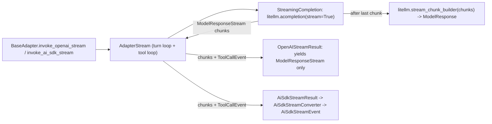

# Streaming path and AI SDK event conversion

Scope: `AdapterStream` (`adapter_stream.py`), `StreamingCompletion` (`litellm_utils/litellm_streaming.py`), and `AiSdkStreamConverter` (`stream_events.py`), plus who consumes their output. Line numbers from commit `579014ab`, read 2026-10-30. Labels: **Read**, **Observed** (run offline), **Inference**.

## 1. Layers

Both public streaming methods drive the same `AdapterStream`. Its unit of output is LiteLLM's `ModelResponseStream` (a Chat Completions chunk), and `ToolCallEvent` between tool rounds.

## 2. `StreamingCompletion` ([litellm_streaming.py:13-71](../../../../libs/core/kiln_ai/adapters/litellm_utils/litellm_streaming.py#L13))

Read.

- Forces `stream_options={"include_usage": True}` (merged with caller options) so the rebuilt response carries usage and cost ([L33-43](../../../../libs/core/kiln_ai/adapters/litellm_utils/litellm_streaming.py#L33)). `stream_options` is a Chat Completions parameter.
- Calls `litellm.acompletion(*args, stream=True, **kwargs)` with the same kwargs the non-streaming path builds (`build_completion_kwargs`), so any routing decision made there (model prefix, extra body) applies to streaming automatically.
- Yields every chunk, keeps them in a list, and after the stream ends sets `self._response = litellm.stream_chunk_builder(chunks)` ([L63-71](../../../../libs/core/kiln_ai/adapters/litellm_utils/litellm_streaming.py#L63)). The final `ModelResponse` that Kiln uses for tool calls, usage, reasoning and the trace is **rebuilt from chunks by LiteLLM**, not received.

**Inference:** a native `litellm.aresponses(stream=True)` path yields Responses streaming events, not `ModelResponseStream`, and `stream_chunk_builder` does not apply. Such a path would need its own chunk-to-`ModelResponseStream` conversion (to keep `invoke_openai_stream`'s public type) and its own final-response assembly.

## 3. `AdapterStream._stream_model_turn` ([adapter_stream.py:209-312](../../../../libs/core/kiln_ai/adapters/model_adapters/adapter_stream.py#L209))

Read. A second copy of the tool loop in `LiteLlmAdapter._run_model_turn` (same limits, `MAX_CALLS_PER_TURN = 10`, `MAX_TOOL_CALLS_PER_TURN = 100`, [L30-31](../../../../libs/core/kiln_ai/adapters/model_adapters/adapter_stream.py#L30)). Per call:

1. `build_completion_kwargs` on a deep copy of messages; `StreamingCompletion(**kwargs)`.
2. Yield each chunk as it arrives.
3. `_validate_response(stream.response)` → `(ModelResponse, choices[0])` ([L373-385](../../../../libs/core/kiln_ai/adapters/model_adapters/adapter_stream.py#L373)). Same `choices[0]` assumption as the non-streaming path, in a separate function.
4. Usage via `adapter.usage_from_response`; append `response_choice.message` (a LiteLLM `Message`) to messages.
5. Tool calls: with `return_on_tool_call`, yield `ToolCallEvent(INPUT_AVAILABLE)` for each and stop; otherwise yield input events, run `adapter.process_tool_calls`, yield output/error events, loop.

Any change to how a reply is read (merging split choices, handling a non-`ModelResponse` type) has to be made in both `LiteLlmAdapter.acompletion_checking_response` and `adapter_stream._validate_response`. The closed PR #1757 changed only the first (see [adapter-request-response-path.md](./adapter-request-response-path.md) §8).

### Observed: `stream_chunk_builder` merges choices across indexes

I fed `litellm.stream_chunk_builder` (1.102.0) hand-built chunks:

- reasoning delta on `choices[].index = 1`, content on `index = 0` → rebuilt response had **one** choice with both `content='answer'` and `reasoning_content='thinking...'`.
- content on `index = 0`, a tool-call delta on `index = 1`, `finish_reason='tool_calls'` on index 1 → **one** choice with content `'Let me add.'`, the tool call, and `finish_reason='tool_calls'`.

So with these shapes, the streaming path would keep a tool call that the non-streaming path drops ([adapter-request-response-path.md](./adapter-request-response-path.md) §3). These were synthetic chunks; the exact chunk shapes LiteLLM's bridge emits are for the LiteLLM subtopic. The raw chunks passed to `invoke_openai_stream` consumers still carry whatever choice index LiteLLM put on them.

## 4. `AiSdkStreamConverter` ([stream_events.py:196-374](../../../../libs/core/kiln_ai/adapters/model_adapters/stream_events.py#L196))

Read. Stateful converter from `ModelResponseStream` to Vercel AI SDK UI-stream events. What it reads from each chunk ([`convert_chunk`, L209-295](../../../../libs/core/kiln_ai/adapters/model_adapters/stream_events.py#L209)):

| Chunk field | Event(s) | Notes |
|---|---|---|
| `choice.finish_reason` | stored; `finalize()` emits `FinishEvent.messageMetadata.finishReason` with `_`→`-` (`tool_calls`→`tool-calls`) | Last non-null wins. |
| `delta.reasoning_content` | `reasoning-start` (new id per block), `reasoning-delta` | Only `reasoning_content`. No reasoning summary index, no encrypted content, no item ids. |
| `delta.content` | closes reasoning; `text-start`, `text-delta` | |
| `delta.tool_calls[]` | closes reasoning and text; `tool-input-start` once id and name are known, `tool-input-delta` per argument fragment | State keyed by `tc_delta.index` (tool-call index, not choice index). |
| chunk with no `choices` and a `usage` | stored; `finalize()` emits `usage.promptTokens`/`completionTokens`/`totalTokens` | Reads `prompt_tokens`, `completion_tokens`, `total_tokens`. |

It iterates `for choice in chunk.choices` without looking at `choice.index`, so deltas on any choice index are treated as one stream.

`ToolCallEvent` (Kiln's own, [L183-193](../../../../libs/core/kiln_ai/adapters/model_adapters/stream_events.py#L183)) becomes `tool-input-available`, `tool-output-available`, `tool-output-error`. `AiSdkStreamResult` ([base_adapter.py:907-983](../../../../libs/core/kiln_ai/adapters/model_adapters/base_adapter.py#L907)) wraps with `start`, `start-step`, `reset_for_next_step()` after tool rounds, `finish-step`, and `finish` (`finishReason: "tool-calls"` when the run is waiting on client tools).

All event models use `ConfigDict(extra="forbid")` ([L15-18](../../../../libs/core/kiln_ai/adapters/model_adapters/stream_events.py#L15)).

**Contract to keep:** if the migration keeps producing `ModelResponseStream` chunks with `reasoning_content`/`content`/`tool_calls` deltas and a trailing usage chunk, this converter needs no change. If a native path is chosen, either convert Responses events into such chunks before this converter, or add a second converter that emits the same AI SDK events.

## 5. Who consumes the streams

Read (grep of the whole repo for `invoke_openai_stream`, `invoke_ai_sdk_stream`, `OpenAIStreamResult`, `AiSdkStreamResult`): **no production caller in this repo**. Only `base_adapter.py`, tests (`test_litellm_adapter_streaming.py`, `test_base_adapter.py`) and the prerelease skill reference them. They are library API for outside users.

The desktop chat feature does not stream through these methods. It proxies to Kiln's hosted server at `{_get_base_url()}/v1/chat/` ([chat/routes.py:161](../../../../app/desktop/studio_server/chat/routes.py#L161)) and parses the returned SSE lines with Kiln's own AI SDK pydantic types ([chat/sse_parser.py:22-26](../../../../app/desktop/studio_server/chat/sse_parser.py#L22)); an event that fails validation is dropped from parsing (returns `None`) but its raw line is still forwarded. **Inference:** the hosted server likely produces these events with `invoke_ai_sdk_stream`, so the AI SDK event shapes are a contract between server and desktop releases; that server is not in this repo, so I could not confirm.

## 6. Paid streaming coverage

Read. `STREAMING_MODELS` and `RETURN_ON_TOOL_CALL_MODELS` ([test_litellm_adapter_streaming.py:43-62](../../../../libs/core/kiln_ai/adapters/model_adapters/test_litellm_adapter_streaming.py#L43)) list only Claude (Anthropic and OpenRouter) and MiniMax (OpenRouter). **No OpenAI model, direct or via OpenRouter, is in the paid streaming or return-on-tool-call tests.** A migration would have to add OpenAI-direct entries to see reasoning, text, tool-call and usage chunks from the new path.
