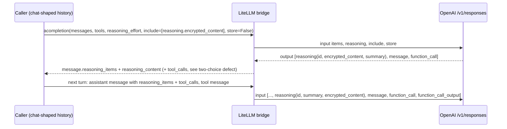

# Reply mapping: `/v1/responses` back to chat shape (non-streamed and streamed)

Scope: LiteLLM 1.102.0 bridge (`completion_extras/litellm_responses_transformation/transformation.py`, cited as `transformation.py`). Experiments ran against a local fake server serving canned Responses API payloads. Scripts and outputs are in `/tmp/claude-0/-home-user-Kiln/dd147251-f363-5e17-95c4-80813a10f3ed/scratchpad/litellm_wire/`: `reply_mapping.py` / `.out`, `stream_mapping.py` / `.out`, `failed_stream_check.py` / `.out`.

## Non-streamed replies

`transform_response()` (`transformation.py:870-959`) calls `_convert_response_output_to_choices()` (`transformation.py:641-782`). The loop walks `response.output` in order:

- `reasoning` item: becomes the pending reasoning item. `reasoning_content` is set to the item's summary texts joined with a single space (`transformation.py:682-688`). A second reasoning item before the next message replaces the first (the variable is a scalar).
- `message` item: one new `Choices` per content part, `finish_reason="stop"`, `index` counting up. The pending reasoning content and item are attached to that choice and then cleared (`transformation.py:690-719`).
- `function_call` (and `apply_patch`, `custom_tool_call`, raw dict tool calls): accumulated into a list.
- After the loop, if any tool calls were accumulated, one more choice is appended with `content=None`, all tool calls, `finish_reason="tool_calls"`, and whatever reasoning is still pending (`transformation.py:767-780`).

So the number of choices depends on the order of output items, not on `n`.

### Observed (fake server, `openai/gpt-5.4`, tools + `reasoning_effort="high"`)

Output `[reasoning, message, function_call]`:

```text
n_choices: 2
choices[0]: finish_reason=stop       content="Let me check the weather."  tool_calls=[]
            reasoning_content="First summary part. Second summary part."
            reasoning_items=[{type: reasoning, id: rs_1, encrypted_content: gAAAA_enc_1, summary: [...2 parts]}]
choices[1]: finish_reason=tool_calls content=None  tool_calls=[get_weather {"city":"Paris"}]
            reasoning_content=None  reasoning_items=None
```

A caller that reads `choices[0]` sees a final answer with `finish_reason="stop"` and never sees the tool call. The reasoning item is on the text choice, not on the tool-call choice.

Output `[reasoning, function_call, function_call]` (no text): one choice, both calls, reasoning attached, `finish_reason="tool_calls"`. Both tool calls carry `index: 0`.

Output `[reasoning rs_1, reasoning rs_2, message]`: one choice with `reasoning_items=[rs_2]` only. `rs_1` is lost. This was flagged by the automated review on PR [#24557](https://github.com/BerriAI/litellm/pull/24557) (March 2026): "`pending_reasoning_item` is a scalar that gets overwritten on every `ResponseReasoningItem` ... all but the last would be silently discarded". The code is the same in 1.108.0rc1 (lines 1189-1195 of that wheel).

Output `[reasoning]` with `status="incomplete"`, `incomplete_details.reason="max_output_tokens"`: one choice, `content=""`, `finish_reason="length"`, reasoning attached (`transformation.py:911-926`, `_build_empty_incomplete_choice`). `content_filter` maps to `finish_reason="content_filter"`.

Output with no recognizable items and status not incomplete: raises `ValueError("Unknown items in responses API response: ...")` (`transformation.py:915-916`). `raw_response.error` set: raises `ValueError(f"Error in response: ...")`, which surfaced as `litellm.APIConnectionError` in the experiment (`failed_stream_check.out`).

### Fields on the returned `ModelResponse`

| Field | Value | Source |
|---|---|---|
| `id` | Upstream Responses id (`resp_...`), decoded from LiteLLM's base64 wrapper if present. Not a `chatcmpl-` id. | `transformation.py:938`; observed `"id": "resp_abc"` |
| `model` | The model string the caller asked for (`gpt-5.4`), not the served snapshot (`gpt-5.4-2026-03-05`). | `transformation.py:930` |
| `choices[i].message.reasoning_content` | Summary texts joined with a space. Raw reasoning text (`content` of a reasoning item, emitted by some non-OpenAI Responses backends) is ignored; see issue [#40654](https://github.com/BerriAI/litellm/issues/40654) (open, reproduced on 1.102.0). | `transformation.py:688` |
| `choices[i].message.reasoning_items` | List of `{type, id, encrypted_content, summary}`. `ChatCompletionReasoningItem` in `types/llms/openai.py:630-636`. | |
| `choices[i].message.thinking_blocks` | Not set. | observed `null` |
| `choices[i].message.annotations` | Copied from `output_text` annotations. | `transformation.py:1254-1288` |
| `usage` | See below. | |
| `_hidden_params` | Merged from the Responses response, including `additional_headers`/`headers` (`x-request-id`). `response_cost` is set. | `transformation.py:942-957` |
| `logprobs` | Never set (no `logprobs` handling in `transformation.py`). | grep |
| Provider metadata | Any non-standard top-level fields of the Responses object that are neither chat nor Responses fields are copied onto the response. | `transformation.py:76-89,939-940` |

### Usage and cost

`ResponseAPILoggingUtils._transform_response_api_usage_to_chat_usage()` (`responses/utils.py:1130-1234`) maps:

- `input_tokens` to `prompt_tokens`, `output_tokens` to `completion_tokens`, total recomputed as their sum.
- `input_tokens_details.cached_tokens` (and audio/text/image/cache_write) to `prompt_tokens_details`.
- `output_tokens_details.reasoning_tokens` to `completion_tokens_details.reasoning_tokens`. `text_tokens`, if present, is reduced so reasoning is not counted twice.
- Extra provider fields are carried onto `Usage`; an upstream `cost` is preserved.

Observed with `input_tokens=1000 (cached 400)`, `output_tokens=300 (reasoning 200)` on gpt-5.4:

```text
usage: prompt_tokens=1000, completion_tokens=300, total_tokens=1300,
       prompt_tokens_details.cached_tokens=400, completion_tokens_details.reasoning_tokens=200
hidden_response_cost: 0.0061
litellm.completion_cost: 0.0061
```

This equals the bundled gpt-5.4 prices: 600 x $2.5e-6 + 400 x $2.5e-7 (cache read) + 300 x $1.5e-5 = $0.0061. The streamed path (below) reports the same cost. Cost depends on the model map (see [routing-rules.md](./routing-rules.md) about the remotely fetched map).

## Streamed replies

When `stream=True`, the bridge calls `aresponses(stream=True)` and wraps the Responses event iterator in `OpenAiResponsesToChatCompletionStreamIterator` (`transformation.py:1305-1630`) inside a normal `CustomStreamWrapper`. Event handling in `translate_responses_chunk_to_openai_stream()` (`transformation.py:1351-1606`):

| Responses event | Chat chunk emitted |
|---|---|
| `response.created` | empty content delta, `id` from the response (decoded) |
| `response.output_item.added` (function_call / custom_tool_call) | tool-call delta with `id` (= `call_id`, see note), `name`, and `index` remapped to a 0-based sequence per stream |
| `response.function_call_arguments.delta` / `custom_tool_call_input.delta` | arguments delta on the same remapped index |
| `response.output_item.done` (function_call or message) | empty delta, no `finish_reason` (fix for issue [#17246](https://github.com/BerriAI/litellm/issues/17246)) |
| `response.output_text.delta` | `delta.content` |
| `response.reasoning_summary_text.delta` | `delta.reasoning_content` on `StreamingChoices(index=summary_index)` |
| `response.completed` / `response.incomplete` | empty delta with `reasoning_items` for every reasoning item in the final output, `finish_reason` (`tool_calls` if any function call, else `stop`; `length`/`content_filter` for incomplete), and `usage` |
| everything else (reasoning item added/done, summary part added/done, content part events, `response.reasoning_text.delta`, ...) | an empty content delta |

All chunks share one stream-scoped id (`_with_stream_scoped_id`).

### Observed stream (`stream_mapping.out`)

Canned SSE: reasoning item with two summary parts (`summary_index` 0 and 1), a message "Let me check.", one function call with `call_id="call_AbC123xyz"`, then `response.completed` with usage.

```text
choice=0 {"reasoning_content": "Part "}
choice=0 {"reasoning_content": "zero."}
choice=1 {"reasoning_content": "Part one."}          <- summary_index 1 used as the choice index
choice=0 {"content": "Let me "}
choice=0 {"content": "check."}
choice=0 {"tool_calls": [{"id": "call_AbC123xyz", "function": {"arguments": "", "name": "get_weather"}, "index": 0}]}
choice=0 {"tool_calls": [{"id": null, "function": {"arguments": "{\"city\":", "name": null}, "index": 0}]}
choice=0 {"tool_calls": [{"id": null, "function": {"arguments": "\"Paris\"}", "name": null}, "index": 0}]}
choice=0 {"reasoning_items": [{"id": "rs_1", "type": "reasoning", "encrypted_content": "gAAAA_enc_1", "summary": [...]}]}
choice=0 {} finish=tool_calls
choice=0 {}   usage: completion_tokens=300, prompt_tokens=1000, total_tokens=1300, reasoning_tokens=200, cached_tokens=400, cost=0.0061
```

Then `litellm.stream_chunk_builder(chunks)`:

```text
n_choices: 1
finish_reason: tool_calls
content: "Let me check."
reasoning_content: "Part zero.Part one."
tool_calls: [get_weather {"city":"Paris"} id=call_AbC123xyz]
reasoning_items: null
usage: ... cost 0.0061 ; completion_cost(rebuilt) = 0.0061
```

What this shows:

1. **Choice index from `summary_index`.** The second summary part arrives on `choices[0].index == 1` (`transformation.py:1541-1551`: `index=cast(int, parsed_chunk.get("summary_index"))`). Each chunk still has a one-element `choices` list, so code that reads `chunk.choices[0]` sees the text; code that groups or validates by `.index` (OpenAI SDK stream accumulators, AI SDK converters, "missing finish_reason for choice 1" style checks) sees a second choice that never finishes. LiteLLM fixed the same pattern for Anthropic (PR [#12666](https://github.com/BerriAI/litellm/pull/12666), "always use choice index=0") and Bedrock (issue [#23178](https://github.com/BerriAI/litellm/issues/23178)). I found no issue or PR for the bridge's `summary_index`. The line is unchanged in 1.106.6 (line 1820) and 1.108.0rc1 (line 2112).
2. **No separator between summary parts when streamed.** "Part zero." and "Part one." are concatenated with nothing between them. The non-streamed path joins them with a space. Onyx (an open-source app on LiteLLM) carries monkey patches for both ("Upstream still passes `reasoning_summary_text.delta` through with no separator between `summary_index` sections" and "Upstream still uses `" ".join()`"), per its LiteLLM upgrade PR [onyx#13192](https://github.com/onyx-dot-app/onyx/pull/13192).
3. **Streamed text plus tool call stays on one choice,** unlike the non-streamed path. The same request gives one choice when streamed and two when not. Issue [#43316](https://github.com/BerriAI/litellm/issues/43316) notes this too: "Streaming is **not** affected".
4. **`reasoning_items` only arrive on the terminal chunk, and `stream_chunk_builder` drops them.** `stream_chunk_builder` (`main.py:8752+`) has no `reasoning_items` handling (grep finds none in `streaming_chunk_builder_utils.py`). It also only reads `chunk["choices"][0]` and ignores `.index`. A caller that rebuilds the final message with `stream_chunk_builder` loses the encrypted reasoning needed to replay the turn. LiteLLM's docs tell streaming callers to collect `delta.reasoning_items` themselves ([OpenAI provider docs, streaming example](https://docs.litellm.ai/docs/providers/openai)). Open issue [#40887](https://github.com/BerriAI/litellm/issues/40887) (2026-09-12) says reasoning items appear only in the terminal event and incremental reasoning items become empty, roleless deltas.
5. **Raw reasoning text is not streamed.** `response.reasoning_text.delta` falls through to the empty-chunk branch (issue [#40654](https://github.com/BerriAI/litellm/issues/40654), open). This matters for non-OpenAI Responses backends; OpenAI models only return summaries.
6. **Usage is complete on the last chunk** including cached and reasoning tokens and a stamped `cost` (`responses/streaming_iterator.py:1320-1336`, `_stamp_responses_usage_cost`). `stream_options.include_usage` is not needed.
7. **Tool call ids.** The chat tool-call id is the Responses `call_id`, except when `call_id` matches `call_\d+` (a Bedrock Mantle quirk), in which case the item id (`fc_...`) is used instead (`responses/litellm_completion_transformation/transformation.py:2220-2229`). My first non-streamed test used `call_id="call_1"` and got `fc_call_1` back for that reason; real OpenAI call ids (`call_` + random alphanumerics) are kept.

### Failures mid-stream

`response.failed` in a bridged stream raised `litellm.MidStreamFallbackError` wrapping `litellm.APIError: The server had an error while processing your request.` (`failed_stream_check.out`). A non-streamed reply with `status="failed"` and `error` set raised `litellm.APIConnectionError: ... Error in response: {...}`. These exception types differ from what the same model raises on the Chat Completions path, which matters for any retry logic that switches on exception class. Issue [#36768](https://github.com/BerriAI/litellm/issues/36768) describes the proxy returning an empty `stop` for `response.failed` in some versions; that was not what I saw on 1.102.0 with the SDK.

## Reasoning round trip (what the caller must do)



- The caller must keep `reasoning_items` on the assistant message in its own history. Kiln's trace format is OpenAI chat; whether it keeps unknown message keys is the Kiln-adapter subtopic's question.
- The bridge replays reasoning items with their `id` and their `encrypted_content`. Whether OpenAI accepts an `id` together with `encrypted_content` when `store` is false is a question for the OpenAI subtopic. Third-party reports conflict: [bifrost#5410](https://github.com/maximhq/bifrost/issues/5410) says a direct call with both works and only their proxy broke it; [LangChain PR #38372](https://github.com/langchain-ai/langchain/pull/38372) keeps encrypted items and drops bare `rs_*` ids when `store=False`.
- Without `include`, items come back with `encrypted_content: null` and replay depends on OpenAI having stored the response.
- Without `reasoning.summary` (no `reasoning_summary`, no dict effort with `summary`, `reasoning_auto_summary` off), OpenAI returns empty summaries and `reasoning_content` stays empty.

## Fixes in later releases (reply side)

From release notes and diffs of downloaded wheels:

- **Text plus tool calls in one choice.** Fixed by PR #44346 on `main` (2026-10-03, per the maintainer's comment on issue [#43316](https://github.com/BerriAI/litellm/issues/43316)), then generalized by PR #46099 to fold every message item, reasoning item and tool call into one `choices[0]` (`_fold_choices_into_one`, docstring "Clients that only read choices[0] must still see every text and tool call."). Released in [v1.103.5](https://docs.litellm.ai/release_notes/v1.103.5/v1-103-5) (2026-10-17: "Tool calls no longer land on a separate `choices[1]`... PR #46099"; "Multiple tool calls in one non-streaming reply now get their own `index` instead of all being 0 - PR #46109"), [v1.105.2](https://docs.litellm.ai/release_notes/) (2026-10-20), and [v1.106.1](https://docs.litellm.ai/release_notes/v1.106.1/v1-106-1). My wheel diffs: present in 1.103.10, 1.104.8, 1.105.7, 1.106.0, 1.106.1, 1.106.6, 1.108.0rc1; absent in 1.102.0 through 1.102.4 and in 1.105.0. **No 1.102.x release has it**, so Kiln's pin `litellm>=1.102.0,<1.103` cannot get it.
- **Served `service_tier`** is carried onto streamed chunks (1.106.6).
- **Still present in 1.108.0rc1:** `summary_index` as the streamed choice index; only the last of consecutive reasoning items kept; streamed summary parts not separated; `stream_chunk_builder` not rebuilding `reasoning_items`.
