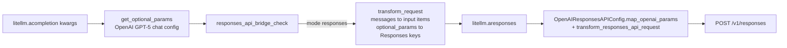

# Request mapping: chat parameters to `/v1/responses` in the bridge

Scope: LiteLLM 1.102.0 (installed in Kiln's virtualenv). Code is in `completion_extras/litellm_responses_transformation/transformation.py` (cited as `transformation.py`) unless noted. Each claim about the wire is backed by a capture from a local fake server. The scripts and full outputs are in `/tmp/claude-0/-home-user-Kiln/dd147251-f363-5e17-95c4-80813a10f3ed/scratchpad/litellm_wire/` (`request_mapping.py` / `request_mapping.out`, `misc_params_check.py` / `misc_params_check.out`, `chat_path_leak_check.py` / `chat_path_leak_check.out`).

## Pipeline



Two parameter filters run in sequence. First the OpenAI chat config (`OpenAIGPT5Config.map_openai_params`, `llms/openai/chat/gpt_5_transformation.py:244-356`) validates and renames chat params. Then the bridge copies only keys that exist in `ResponsesAPIOptionalRequestParams` (`types/llms/openai.py:1237-1268`), plus a few special cases (`transformation.py:487-519`):

```python
for key, value in optional_params.items():
    if value is None:
        continue
    if key in ("max_tokens", "max_completion_tokens"):
        responses_api_request["max_output_tokens"] = value
    elif key == "tools" and value is not None:
        responses_api_request["tools"] = self._convert_tools_to_responses_format(...)
    elif key == "response_format":
        ...text_format...
    elif key == "tool_choice":
        responses_api_request["tool_choice"] = self._normalize_tool_choice_for_responses_api(value)
    elif key == "stream_options":
        ...
    elif key in ResponsesAPIOptionalRequestParams.__annotations__:
        responses_api_request[key] = value
    elif key == "previous_response_id":
        ...
    elif key == "reasoning_effort":
        responses_api_request["reasoning"] = self._map_reasoning_effort(value)
    elif key == "web_search_options":
        self._add_web_search_tool(responses_api_request, value)
```

Any other key is dropped with no error and no log line. The allowed keys are: `include`, `instructions`, `max_output_tokens`, `metadata`, `parallel_tool_calls`, `previous_response_id`, `reasoning`, `store`, `background`, `stream`, `temperature`, `text`, `tool_choice`, `tools`, `top_p`, `truncation`, `user`, `service_tier`, `safety_identifier`, `prompt`, `max_tool_calls`, `prompt_cache_key`, `prompt_cache_retention`, `prompt_cache_options`, `stream_options`, `top_logprobs`, `partial_images`, `context_management`.

## Parameter-by-parameter table (1.102.0)

| Chat parameter | What reaches `/v1/responses` | Evidence |
|---|---|---|
| `messages` (system) | Leading system messages with string content are joined with a single space into `instructions`. Later system messages, or non-string ones, become `{"type":"message","role":"system"}` input items. A system-only request becomes one system input item. | `transformation.py:373-402,580-588`; capture: `"instructions": "You are helpful. Second system prompt."` |
| `messages` (user/assistant text) | `{"type":"message","role":...,"content":[{"type":"input_text"|"output_text",...}]}`. Assistant items carry no `id`. | capture |
| `messages` (assistant `tool_calls`) | Reasoning items for that turn first, then the assistant text as a message (if any), then one `{"type":"function_call","call_id","name","arguments"}` per call. No `id` on the function call item. | `transformation.py:438-471`; capture |
| `messages` (tool) | `{"type":"function_call_output","call_id":<tool_call_id>,"output":[{"type":"input_text","text":...}]}`. Output is always a list, even for a plain string. | `transformation.py:403-437`; capture |
| assistant `reasoning_items` | Replayed as `{"type":"reasoning","id","summary","encrypted_content"}` before that turn's message and calls. If an item has no `id`, LiteLLM invents one: `"id": r_item.get("id") or f"rs_{id(r_item)}"` (a Python object id). | `transformation.py:271-283`; capture: `{"id": "rs_139690672452096", ...}` |
| assistant `thinking_blocks` (no `reasoning_items`) | Converted to a reasoning item with no `id`. Plain thinking text becomes a `summary_text` entry. | `litellm_core_utils/prompt_templates/common_utils.py:2056-2070`; capture: `{"type": "reasoning", "summary": [{"type": "summary_text", "text": "plain thoughts"}]}` |
| assistant `reasoning_content` only | Dropped. | capture |
| `tools` (function) | Flattened to `{"type":"function","name","parameters","strict","description"}`. `strict` and `description` are copied as-is, so a tool without them is sent with `"strict": null` and `"description": null`. | `transformation.py:1100-1110`; capture: `"strict": null, "type": "function", "description": null` |
| `tools` (custom grammar) | Flattened `{"type":"custom","name",...}`. | `transformation.py:1111-1122` |
| `tool_choice` | `"auto"`/`"none"`/`"required"` pass through. `{"type":"function","function":{"name":X}}` becomes `{"type":"function","name":X}`. | `transformation.py:294-311`; capture |
| `parallel_tool_calls` | Copied. | capture |
| `response_format` json_schema | `text.format = {"type":"json_schema","name":json_schema.name or "response_schema","schema":...,"strict": json_schema.get("strict", False)}`. A missing `strict` becomes an explicit `false`. | `transformation.py:1236-1246`; capture: `"strict": false` without, `"strict": true` with |
| `response_format` json_object / text | `text.format = {"type":"json_object"}` / `{"type":"text"}`. | `transformation.py:1247-1250` |
| `reasoning_effort` string | `reasoning = {"effort": <value>}` if the value is one of `none, minimal, low, medium, high, xhigh, max`. Any other string gives `reasoning: None`, which is dropped. With `litellm.reasoning_auto_summary` or `LITELLM_REASONING_AUTO_SUMMARY=true`, `summary: "detailed"` is added. | `transformation.py:1157-1174`, `types/llms/openai.py:1889`; capture: `"reasoning": {"effort": "max"}` |
| `reasoning_effort` dict | Passed as `Reasoning(**dict)`, so `{"effort":"medium","summary":"detailed"}` arrives unchanged. | capture |
| `reasoning_summary` / `reasoningSummary` (kwarg or in `extra_body`) | Folded into `reasoning.summary`. | capture: `"reasoning": {"effort": "high", "summary": "auto"}` |
| `store` | Copied only if the caller passes it. The bridge never sets it. With no `store`, OpenAI's server-side default applies. | capture: `"store": false` only when passed |
| `include` | Copied if passed as a kwarg or in `extra_body`. The bridge never adds `reasoning.encrypted_content` on its own. | capture |
| `temperature` | Chat config runs first. On gpt-5.4 with reasoning active and `temperature != 1`, it raises `UnsupportedParamsError` ("gpt-5.4 doesn't support temperature=0.2 while reasoning is active...") unless `drop_params=True`, which drops it. When allowed, it is copied. | `gpt_5_transformation.py:331-350`; capture |
| `top_p` | Same gate as temperature for models that support `none` effort, then copied. | `gpt_5_transformation.py:312-329`; capture on gpt-4.1: `"top_p": 0.5` |
| `logprobs` | Dropped by the bridge with no error (not a Responses key). | capture on `openai/responses/gpt-4.1`: `logprobs=True` absent from body |
| `top_logprobs` | Copied. The bridge does not add `include: ["message.output_text.logprobs"]` and never maps logprobs back onto the chat reply (no `logprobs` handling anywhere in `transformation.py`). | capture: `"top_logprobs": 3` |
| `max_tokens` / `max_completion_tokens` | GPT-5 chat config renames `max_tokens` to `max_completion_tokens`; the bridge maps either to `max_output_tokens`. Values below 16 are raised to 16 by `OpenAIResponsesAPIConfig._enforce_min_max_output_tokens`. | `transformation.py:496-497`; `llms/openai/responses/transformation.py:36,172-182`; capture: `"max_output_tokens": 500` |
| `n`, `seed`, `stop`, `logit_bias`, `presence_penalty`, `frequency_penalty` | Dropped with no error, even without `drop_params`. A caller asking for `n=2` gets one choice. | captures for `n=2`, `seed=3`, `stop=["x"]` |
| `allowed_openai_params` | Does not reach the bridge's filter. `n=2, allowed_openai_params=["n"]` still sends no `n`. `completion()` itself appends `"reasoning_effort"` to `allowed_openai_params` when it knows it will bridge (`main.py:5440-5444`), so chat-side validation does not reject `reasoning_effort` for a `responses/` model. | capture |
| `drop_params` | Applies to the chat config step (temperature, logprobs, unsupported effort levels) and to `get_optional_params_responses_api`. The bridge's own key filter drops unknown keys whether or not it is set. | captures |
| `verbosity` | Dropped. 1.102.0 has no mapping to `text.verbosity`. | capture: `verbosity="low"` absent |
| `prompt_cache_key`, `service_tier`, `safety_identifier`, `truncation` (via `extra_body`) | Copied. | capture |
| `user` | Copied, truncated to 64 characters. | `transformation.py:552-557`; capture |
| `metadata` | Not sent upstream. It is treated as LiteLLM logging metadata and moved into `litellm_metadata`. | `transformation.py:521-538`; capture |
| `extra_body` | Keys that are Responses params (plus `previous_response_id`, `reasoning_effort`) are lifted to the top level. Every other key is dropped, because `extra_body` is popped and never re-attached. | `transformation.py:1128-1155`; capture: `extra_body={"foo_unknown": 1, "truncation": "auto"}` sends only `truncation` |
| `stream_options` | Only `include_obfuscation` is kept; `include_usage` is dropped. Usage always arrives in `response.completed` anyway. | `responses/utils.py:47-55`; capture |
| `cache_control_injection_points` | No `cache_control` reached the wire. Text content blocks are rebuilt as `{type,text}` only, and `OpenAIResponsesAPIConfig.remove_cache_control_flag_from_input_and_tools` strips any `cache_control` left on input items and tools. | `llms/openai/responses/transformation.py:339-369`; capture |
| headers | Passed as `extra_headers`. | `transformation.py:636-637` |

### A full captured request

Input: system x2, user, assistant with text + tool call + `reasoning_items`, tool result, two assistant turns, user; two tools (one without `strict`, one with `strict: true`); `tool_choice` naming a function; `reasoning_effort="high"`; `response_format` json_schema without `strict`; `max_tokens=500`; `parallel_tool_calls=False`; an 80-character `user`; `metadata`. Wire body (from `request_mapping.out`, trimmed):

```json
{
 "model": "gpt-5.4",
 "input": [
  {"type": "message", "role": "user", "content": [{"type": "input_text", "text": "Weather in Paris?"}]},
  {"id": "rs_prev", "summary": [{"text": "Need weather tool.", "type": "summary_text"}], "type": "reasoning", "encrypted_content": "gAAAA_encrypted_blob"},
  {"type": "message", "role": "assistant", "content": [{"type": "output_text", "text": "Checking."}]},
  {"type": "function_call", "call_id": "call_1", "name": "get_weather", "arguments": "{\"city\":\"Paris\"}"},
  {"type": "function_call_output", "call_id": "call_1", "output": [{"type": "input_text", "text": "Sunny, 20C"}]},
  {"type": "message", "role": "assistant", "content": [{"type": "output_text", "text": "It is sunny."}]},
  {"type": "message", "role": "assistant", "content": [{"type": "output_text", "text": "Plain assistant turn carrying a reasoning summary only."}]},
  {"type": "message", "role": "user", "content": [{"type": "input_text", "text": "Thanks. And Berlin?"}]}
 ],
 "instructions": "You are helpful. Second system prompt.",
 "max_output_tokens": 500,
 "parallel_tool_calls": false,
 "reasoning": {"effort": "high"},
 "text": {"format": {"type": "json_schema", "name": "out", "schema": {"type": "object"}, "strict": false}},
 "tool_choice": {"type": "function", "name": "get_weather"},
 "tools": [
  {"name": "get_weather", "parameters": {...}, "strict": null, "type": "function", "description": "Get weather"},
  {"name": "strict_tool", "parameters": {..., "additionalProperties": false}, "strict": true, "type": "function", "description": null}
 ],
 "user": "uuuuuuuuuuuuuuuuuuuuuuuuuuuuuuuuuuuuuuuuuuuuuuuuuuuuuuuuuuuuuuuu"
}
```

No `store`, no `include`. `metadata` is absent.

## Things that matter for a caller like Kiln

1. **`strict` on tools is sent as `null` when the chat tool does not set it.** The OpenAI SDK installed alongside (openai 2.41.0) documents `FunctionToolParam.strict` as `Required[Optional[bool]]` with the docstring "Whether to enforce strict parameter validation. Default `true`." On Chat Completions an omitted `strict` means non-strict. What OpenAI does with an explicit `null` on Responses (strict, non-strict, or default) is for the OpenAI-docs subtopic to settle. I found no LiteLLM issue about it. Other frameworks treat the default flip as a real behavior change: LangChain PR [#39309](https://github.com/langchain-ai/langchain/pull/39309) sends `strict: false` explicitly ("The Chat Completions API treats an omitted `strict` key as `False`, but the Responses API defaults it to `True`"), and RubyLLM issue [#843](https://github.com/crmne/ruby_llm/issues/843) describes optional tool parameters being filled in after the switch. A caller that wants chat-equivalent behavior through the bridge has to set `strict` on every tool itself.
2. **`text.format.strict` becomes an explicit `false` when absent.** Chat Completions' own default for `json_schema.strict` is also non-strict, so this matches chat behavior. A caller that wants strict structured output must pass `"strict": true` in `response_format.json_schema`; the bridge keeps it (capture shows `"strict": true`). Unchanged through 1.108.0rc1 (`transformation.py:1804` of that wheel).
3. **`store` is never set by the bridge.** The request goes out with no `store` key, so OpenAI's default for `/v1/responses` applies. The OpenAI subtopic covers what that default is and what it means for retention. A caller that wants the same retention as Chat Completions has to pass `store=False` itself. It is a named `completion()` parameter in 1.102.0 and passes through (capture). Unchanged through 1.108.0rc1. I found no LiteLLM issue or PR asking the bridge to default it.
4. **Encrypted reasoning needs both `store` and `include` from the caller.** The bridge only round-trips `encrypted_content` if the caller sends `include=["reasoning.encrypted_content"]`. LiteLLM's docs say so: "Pass `include=["reasoning.encrypted_content"]` on every call where you want that token returned" ([OpenAI provider docs, Multi-turn Conversations with `reasoning_items`](https://docs.litellm.ai/docs/providers/openai)).
5. **Responses-only kwargs leak when the call does not bridge.** `include` is not a chat parameter, but when the same call stays on Chat Completions (for example gpt-5.4 with reasoning and no tools, or any non-GPT-5 OpenAI model) LiteLLM forwards it to `/v1/chat/completions` unchanged. Captured bodies: `{"model": "gpt-5.4", "reasoning_effort": "high", "store": false, "include": ["reasoning.encrypted_content"]}` and `{"model": "gpt-4.1", "include": [...]}`. I did not test what OpenAI returns for that; an unknown-parameter 400 is likely but unverified. Because the routing decision is made inside LiteLLM per call, a caller cannot safely always send `include`.
6. **Silent drops.** `n`, `seed`, `stop`, `logprobs`, `verbosity`, unknown `extra_body` keys, and `allowed_openai_params` overrides all vanish without an error. On the Chat Completions path some of these would have reached OpenAI.
7. **Invented reasoning ids.** A replayed reasoning item without an `id` gets `rs_<python object id>`. OpenAI rejects ids it did not mint ("Item with id 'rs_...' not found", as reported in other projects, see [openclaw#78897](https://github.com/openclaw/openclaw/issues/78897)). This only happens if the caller strips ids. It was fixed in 1.106.0 by PR #44132 ("Drop LiteLLM-minted reasoning items when replaying Responses history to OpenAI and Azure", [v1.106.0 release notes](https://docs.litellm.ai/release_notes/v1.106.0/v1-106-0)). In 1.106.0+ an item with no id is sent with no id.

## Changes in later releases (request side)

Checked by diffing the downloaded wheels against 1.102.0:

- `verbosity` is mapped into `text.verbosity` from 1.103.10, 1.104.8, 1.105.7 and 1.106.x onward (not in 1.102.4).
- Reasoning items without an id are sent without an id from 1.106.0 (`_reasoning_item_to_response_input` docstring: "An item without an id is sent without one: the Responses API accepts that and verifies the encrypted content on its own, while it rejects any id it did not mint.").
- `prompt_cache_breakpoint` markers are kept on content blocks for models that support them (1.106.0, PR #44119).
- `_map_reasoning_effort` no longer filters strings against the `REASONING_EFFORT` literal in 1.106.6; any string is forwarded.
- Still present in 1.108.0rc1: `strict=function_tool.get("strict")` (line 1662), `"strict": json_schema.get("strict", False)` (line 1804), no default for `store`.
